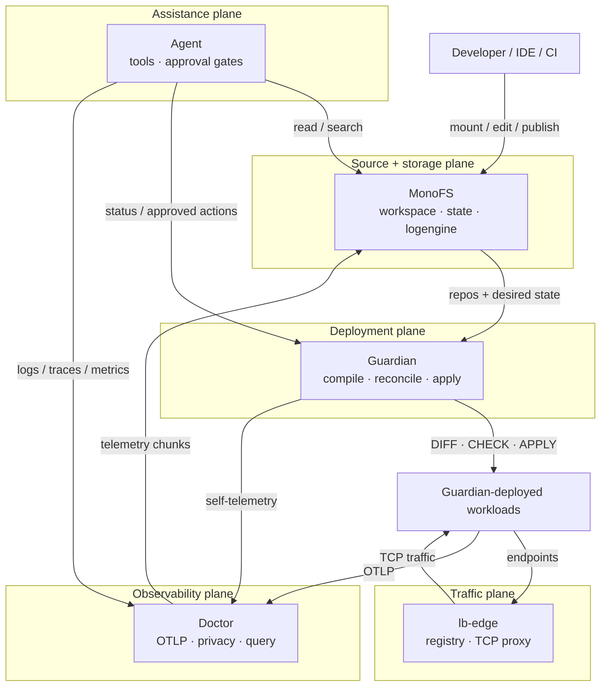

# Strata

**One surface for your source, deployments, and telemetry.**

Strata is an open-source, self-hosted infrastructure stack built and maintained
in the open by [@radryc](https://github.com/radryc). It connects five planes:

| Plane | Component | What it does |
| --- | --- | --- |
| Source + storage | [MonoFS](https://github.com/radryc/monofs) | Mounts many Git repositories as one writable virtual monorepo, and stores the platform's state, images, and telemetry chunks |
| Deployment | [Guardian](https://github.com/radryc/guardian) | Compiles desired state into typed assets and runs `DIFF → CHECK → APPLY` against Kubernetes, Docker, AWS, or local backends |
| Observability | [Doctor](https://github.com/radryc/doctor) | Receives OTLP, tokenizes sensitive fields before persistence, and serves traces, logs, metrics, and Guardian health |
| Traffic | [lb](https://github.com/radryc/lb) | L4 registry and TCP proxy for routing external ports to live backends (LB-Edge) |
| Assistance | Agent | Answers platform questions and proposes changes behind approval gates (in development) |

MonoFS is the substrate. Guardian and Doctor keep their state in it. LB-Edge
routes traffic to what Guardian deployed. Agent reads all four.

**Website:** <https://stratasre.com> · **Landing repo:** <https://github.com/radryc/hub>

## How the pieces fit



## Repository map

| Repository | Language | Role |
| --- | --- | --- |
| [monofs](https://github.com/radryc/monofs) | Go | Distributed filesystem and source plane: virtual monorepo, session VCS, search, OCI registry, Bazel cache, logengine |
| [guardian](https://github.com/radryc/guardian) | Go | Declarative deployment control plane: partitions, intents, typed assets, drift, push/apply, rollback |
| [doctor](https://github.com/radryc/doctor) | Go | Privacy-first telemetry backend: OTLP ingest, HMAC tokenization, trace/log/metric query, Grafana-compatible APIs |
| [lb](https://github.com/radryc/lb) | Go | L4 load balancer: registry control plane, TCP proxy, Kubernetes endpoints agent |
| [kvs](https://github.com/radryc/kvs) | Go | Embedded key-value store backing Guardian and MonoFS state |
| [cfg](https://github.com/radryc/cfg) | Go | Versioned config store with a KVS hot tier and encrypted packager archives |
| [packager](https://github.com/radryc/packager) | Go | Encrypted, compressed object-store archives with O(1) random access |
| [aws](https://github.com/radryc/aws) | TypeScript | CDK project that deploys MonoFS and Guardian to ECS Fargate |
| [k8s-top](https://github.com/radryc/k8s-top) | Go | Kubernetes metrics exporter for pods and containers, annotated with Guardian partition/intent/asset labels |
| [hub](https://github.com/radryc/hub) | HTML/CSS | Static landing page for stratasre.com |

`agent` and `stratatools` are currently private. They add the assistant and the
packaged partition templates, but the public repositories above are enough to
build and run the core engines.

Other repositories on [@radryc](https://github.com/radryc?tab=repositories) —
`memegen`, `devdns`, `awsasset`, `promtest`, and friends — are separate
experiments, not part of Strata.

## Bootstrap

The end-to-end harness is `demo-divisions/demo.sh` in the Strata workspace.
`scripts/bootstrap.sh` delegates to it:

```bash
./scripts/bootstrap.sh up                    # kind control plane + full demo
./scripts/bootstrap.sh start --k8s           # control plane only, on kind
./scripts/bootstrap.sh control-plane --k8s up
./scripts/bootstrap.sh control-plane --aws up
```

Set `STRATA_DEMO_DIR` if the harness lives somewhere other than
`../demo-divisions`.

`--k8s` uses a local [kind](https://kind.sigs.k8s.io/) cluster. To use a real
Kubernetes cluster, point `KUBECONFIG` at it and deploy the Guardian partitions
with `guardianctl`; the demo's kind-only steps (loading images into the cluster
and forwarding ports) do not apply.

The harness uses workspace pieces that are not published yet (`stratatools`
partition templates, `demo-divisions`, and the Agent). The public repositories in
the map above are the source of truth for the engines themselves.

## Build from source

Clone this repository, then let the script create the sibling checkout layout
that the Go `replace` directives expect:

```bash
git clone https://github.com/radryc/strata.git
cd strata
./scripts/clone.sh
```

The result is:

```text
strata/          # this repo — the front door
monofs/          # sibling checkouts
guardian/
doctor/
lb/
kvs/
cfg/
packager/
aws/
k8s-top/
hub/
```

`kvs` and `cfg` must stay next to `monofs`; `monofs` must stay next to
`guardian` and `doctor`. The clone script defaults to the parent directory, so
the layout is correct out of the box.

Then build the stack in dependency order:

```bash
cd ../monofs
make build

cd ../guardian
mkdir -p bin
go build -o bin/guardianctl ./cmd/guardianctl
go build -o bin/guardiand ./cmd/guardiand

cd ../doctor
make build
```

Start MonoFS in one terminal:

```bash
cd ../monofs
make run-cluster        # router on localhost:9090, UI on localhost:8080
```

Then point Guardian and Doctor at the router (`localhost:9090`) and follow
their READMEs for the first partition and telemetry query.

Prerequisites are Go 1.26.4, Node 22, FUSE 3 for mounting, Docker for image
builds, and `kubectl` plus `kind` for the demo.

## Status

Strata is pre-1.0 and under active development by a single maintainer. Tags mark
known-good checkpoints; interfaces still move. Issues and pull requests are
welcome on the individual repositories.

## License

Apache-2.0. See [LICENSE](LICENSE). Individual repositories may carry their own
license file; check each one.
