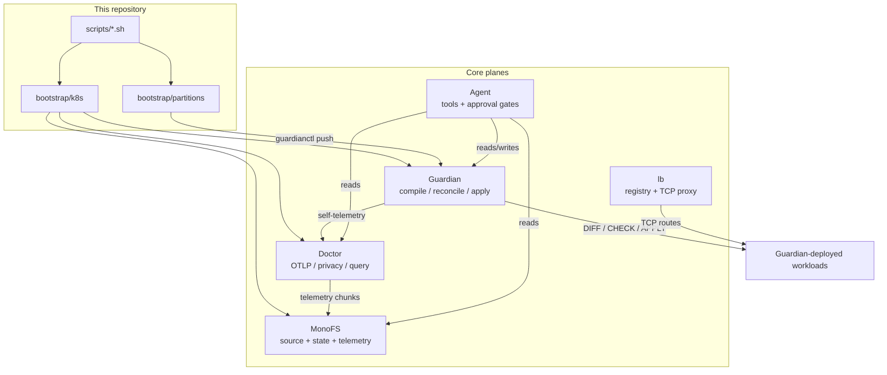

# Strata repository architecture

This repository is the public entry point for the Strata platform. It does not
contain the engines; it contains the bootstrap scripts, reference manifests,
examples, and the documentation that ties the component repositories together.

## Scope

| In this repository | In the component repositories |
|---|---|
| Bootstrap and teardown scripts for kind, Kubernetes, and AWS | MonoFS, SQLAggregator, Guardian, Doctor, LB, Agent, KVS, CFG, Packager, k8s-top, AWS CDK |
| Reference Kubernetes manifests under `bootstrap/k8s/` | Guardian partition definitions owned by each component |
| A prepared application partition under `bootstrap/partitions/` | Runtime images and binaries |
| Public documentation under `docs/` | Component architecture, security, and operating guides |
| `repos.txt` build order and the `clone.sh` helper | — |

## Repository layout

```text
bootstrap/
  kind/cluster.yaml          kind cluster definition
  k8s/                       reference control-plane manifests
  partitions/                prepared application partitions
    onboarding-app/          the only partition with content
    aws-app/                 empty placeholder (no config or intents)
  auth/                      development Authentik SSO reference (authentik.yaml)
examples/
  aws-app/                   sample application for the AWS deployment
  multicloud-monitoring/     AWS + GCP + k8s deployment authored as GitOps state
  onboarding-app/            sample application for the onboarding flow
scripts/
  bootstrap.sh               dispatcher for up, down, k8s, k8s-down, aws, onboard, authentik
  clone.sh                   clone component repositories as siblings
  dev-kind-up.sh             build images, create kind cluster, bootstrap
  dev-kind-down.sh           stop port-forwards and delete the kind cluster
  k8s-up.sh                  build/push images and deploy to a cluster
  k8s-down.sh                remove the Strata namespaces from the current cluster
  aws-up.sh                  deploy the AWS CDK stack
  onboard-app.sh             onboard an application repository
  dev-kind-authentik.sh      deploy Authentik and enable OIDC for the local UIs
  create-authentik-user.sh   create an Authentik user and print an access-policy grant
  lib/bootstrap-common.sh    shared helpers: secrets, rendering, port-forwards, guardianctl
docs/                        operator guides and this architecture document
repos.txt                    component repositories in build order
```

## Platform topology

The platform spans five planes. The public bootstrap starts the three core
planes (MonoFS, Guardian, and Doctor); LB and Agent run from their own
repositories. Each plane is one or more component repositories:



`bootstrap/k8s` starts MonoFS, Guardian, and Doctor directly. The component
partitions under each engine repository are then ingested into MonoFS and
imported by Guardian; they observe the bootstrap workloads and add probes
instead of creating duplicate deployments.

## Bootstrap flow

1. `scripts/clone.sh` reads `repos.txt` and clones each component as a sibling
   directory. The Go `replace` directives in MonoFS, Guardian, Doctor, and CFG
   expect this layout; MonoFS additionally needs a `../sqlagregator` checkout.
2. `scripts/dev-kind-up.sh` builds the images, creates the kind cluster, applies
   `bootstrap/kind/cluster.yaml` and `bootstrap/k8s/`, then ingests the
   component repositories and imports their partitions.
3. `scripts/k8s-up.sh` repeats the deployment against the current kubeconfig;
   `make k8s ARGS=...` forwards flags such as `--build`/`--push`, and image
   prefixes, tags, and namespaces come from environment variables.
4. `scripts/onboard-app.sh` pushes an application repository's
   `guardian/partitions/<name>` bundle (or registers the repository with
   `--register` so Guardian imports it) using `guardianctl`.
5. `scripts/aws-up.sh` deploys the AWS CDK stack from the `aws` repository.

The checked-in manifests use the `strata` namespace and the placeholders
`__APP_IMAGE__`, `__IMAGE_PREFIX__`, `__IMAGE_TAG__`, and `__NAMESPACE__`.
Scripts render them into `.strata/`; the checked-in files are not modified.

## Component responsibilities

| Repository | Responsibility |
|---|---|
| `monofs` | Distributed filesystem, Git workspace, source/state/log-engine plane |
| `sqlagregator` | Federated SQL coordinator for CloudWatch, BigQuery, ClickHouse, and DuckDB; used by MonoFS |
| `guardian` | Declarative deployment control plane: partitions, intents, typed assets, reconciliation, drift |
| `doctor` | Privacy-first telemetry backend: OTLP ingest, HMAC tokenization, trace/log/metric query, alerts |
| `lb` | L4 registry and TCP proxy (LB-Edge) |
| `agent` | Assistance plane: platform questions, incident investigation, approval-gated changes |
| `kvs` | Raft-replicated versioned KV backing Guardian and MonoFS state |
| `cfg` | Two-tier versioned config store over KVS and packager |
| `packager` | Encrypted, compressed object-store archives with random access |
| `k8s-top` | Kubernetes pod/container metrics exporter with Guardian identity labels |
| `aws` | CDK project deploying MonoFS and Guardian to ECS Fargate |

## Versioning and release model

Each component repository is versioned independently with semantic tags
(`vMAJOR.MINOR.PATCH`) and a GitHub release. `repos.txt` lists the recommended
build order, not a lockstep version set. The bootstrap pulls component source
at build time, so a deployment is reproducible from the clones created by
`clone.sh`.

## Related documentation

- [Platform architecture set](architecture/README.md) — component topology, flows, and shared contracts
- [Platform overview](architecture/platform-overview.md) — what each plane and component does, and how they connect
- [Local kind stack](local-kind.md)
- [Kubernetes deployment](kubernetes.md)
- [AWS deployment](aws.md)
- [Access and login](access-and-login.md)
- [Application onboarding](onboarding-application.md)
- [Prepared bootstrap partition](bootstrap-partition.md)
