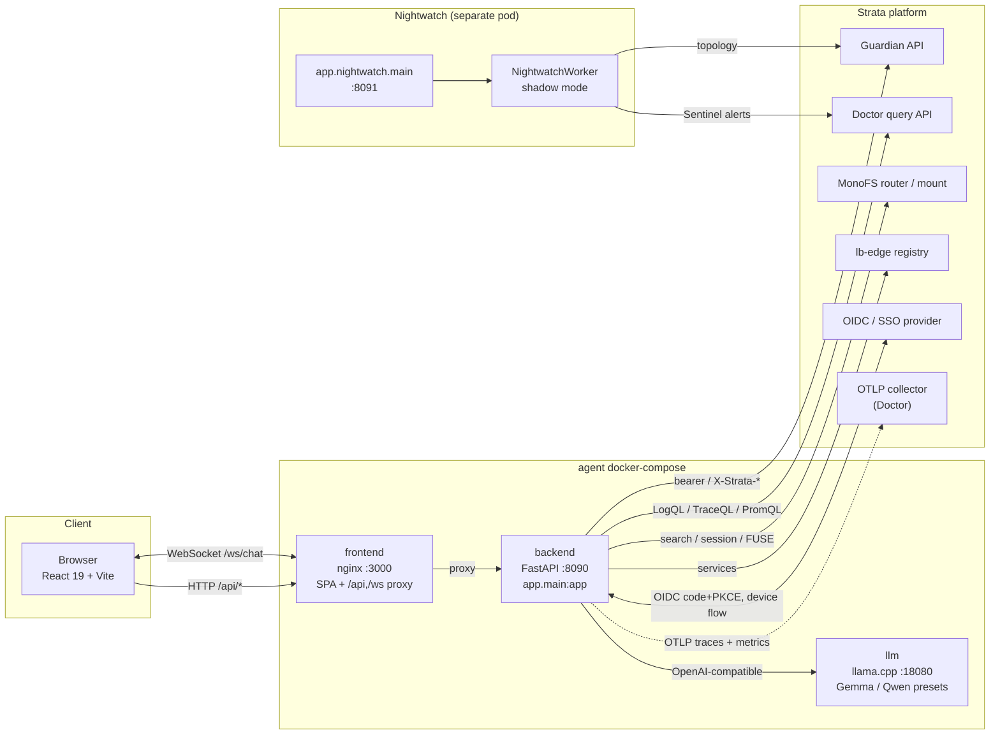
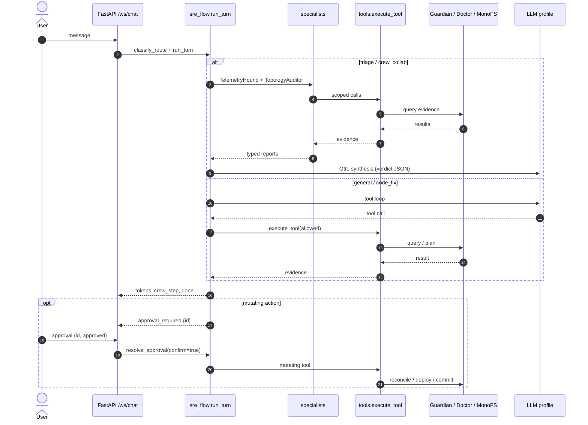

# Agent — Assistance Plane Architecture

> **Scope:** `agent/` — FastAPI backend, React frontend, Nightwatch worker, and LLM integration.
> **Deep references:** [`agent/README.md`](https://github.com/radryc/agent/blob/main/README.md).

The Agent is the assistance plane. It turns platform evidence into answers, plans changes, and executes them only after an explicit approval. It is deliberately not a generic chatbot: operational claims must be backed by a tool result, and every mutating tool passes through a confirmation gate.

## Deployment topology

The interactive stack is one FastAPI application, one React/nginx container, and an optional llama.cpp server. Nightwatch runs from the same image as a separate ASGI application in its own Guardian partition.

**Entry points:** `backend/app/main.py` builds `FastAPI(title="lagent")`; `backend/app/server.py` is the uvicorn launcher that applies the shared `STRATA_TLS_*` contract. The frontend routes (`frontend/src/App.tsx`) are `/`, `/dashboard`, `/chat/:sessionId`, `/nightwatch`, `/settings`, and the unauthenticated `/embed/ask` drawer.

## Key Components

| Component | Code home | Responsibility |
| --- | --- | --- |
| API surface | `backend/app/api/` | Chat (`POST /api/chat`, `WS /ws/chat`), sessions, agent status/models, settings, auth, Guardian read proxy, Nightwatch read proxy, proposals, media, health/metrics. |
| Route classifier | `agent/sre_flow.py` (`StrataSREFlow`, `classify_route`, `run_turn`, `resolve_approval`) | Classifies each turn into `general`, `triage`, `crew_collab`, `code_fix`, or `mutate_infra` and runs the matching deterministic sequence. |
| Tool loop | `agent/loop.py` (`run_agent_turn`, `ensure_session`) | Parses JSON and DSML tool calls, executes up to `LLM_MAX_TOOL_ROUNDS`, injects results, retries malformed calls with a GBNF grammar, escalates on stall, forces a final completion. |
| Personas & routing | `agent/personas.py`, `agent/router.py` | Otto (SRE) and Steve (software engineering); auto routing by explicit `@otto`/`@steve`, keyword votes, sticky follow-ups, then a local-model classifier. |
| Specialists | `agent/specialists.py` | Bounded mini-loops with explicit allowlists: TelemetryHound, TopologyAuditor, OutageOtto, SoftwareSteve. |
| Tool catalog | `agent/tools.py` | 53 `Skill` records in `general`, `strata`, `guardian`, `doctor`, `nightwatch`, `monofs`, `workspace`; `execute_tool` enforces `allowed` and audits denials. |
| LLM client | `llm/client.py`, `llm/presets.py` | OpenAI-compatible completions with profiles `local`, `steve`, `fallback`, `provider:<name>`; `LLM_MODE` selects local, external, or hybrid. |
| Workspace sandbox | `agent/workspace.py` | Confined MonoFS workspace: FUSE mount at `/workspace` or headless session socket, local overlay at `/data/monofs-overlay`, `monofs-session` commit/push. |
| Nightwatch | `nightwatch/` | Shadow-mode alert observer: assignments, incident correlation, evidence collection, findings, escalation — never executes. |
| Sessions | `agent/session.py`, `api/sessions.py` | SQLite (`/data/lagent.db`) sessions and messages, persona attribution. |
| Frontend | `frontend/src/` | Chat, Crew timeline, Approval/Verdict cards, dashboard, Nightwatch, terminal, settings, embed drawer. |
| Telemetry | `telemetry/otel.py` | OTLP gRPC traces and metrics with FastAPI instrumentation. |

## How It Works

### 1. A turn goes through deterministic routing, not a free-form agent

`classify_route` decides the shape of the turn before any model loop starts:

| Route | Trigger | Execution |
| --- | --- | --- |
| `general` | Ordinary conversation | Legacy single-agent loop restricted to 11 general tools. |
| `triage` | Operational/telemetry question | TelemetryHound + TopologyAuditor run concurrently; typed reports; four-golden-signal coverage check; Otto synthesizes a strict JSON verdict. |
| `crew_collab` | Operational **and** code signals | Triage, then SoftwareSteve in the workspace. |
| `code_fix` | Code change request | Steve only, inside the MonoFS workspace. |
| `mutate_infra` | Reconcile/deploy/push language | Registers a `PendingApproval`; executes nothing until approval. |

The LLM never sees the whole tool catalog: `personas.allowed_tools()` plus the specialist sets (`TELEMETRY_TOOLS`, `TOPOLOGY_TOOLS`, `STEVE_FLOW_TOOLS`, `OTTO_EXEC_TOOLS`, `GENERAL_TOOLS`) bound what each role can call.

### 2. Tools are typed, scoped, and evidence-producing

Each `Skill` declares its parameters, status text, category, and `mutating` flag. `execute_tool` checks membership in the caller's allowlist before dispatch and writes an audit record on denial (`scope="agent-tool"`). The tool families are:

- **Guardian:** overview, partitions, partition detail, intent activity, catalog, asset describe, intent plan, validate, reconcile, deploy.
- **Doctor:** log services/search, LogQL schema/query/labels, TraceQL query/tags/metrics, metric names/labels/query, recent traces, trace detail, Guardian events, event analysis.
- **MonoFS:** `monofs_search`, `monofs_status`, `monofs_refs`.
- **Workspace:** status, list, read, write, diff, session actions, commit, push.
- **General:** time, calculation, web search, secure fetch, image generation.
- **Nightwatch:** read-only incident/assignment views.

Telemetry-shaped questions have guardrails: the loop nudges the model to call a tool, appends an evidence reminder, and auto-runs a metric value query when the model only listed a catalog.

### 3. Mutation is a two-phase approval, not a tool flag

Every `mutating=True` skill requires `confirm=true`. `mutate_infra` turns register a `PendingApproval` (`_register_approval` / `_workspace_approval`) and emit `approval_required`; `resolve_approval` executes only when the user approves. The default deploy path is `plan_only=true`. Workspace commit/push is the only autonomous exception, and only when `AUTO_PUSH_ENABLED=true`.

### 4. The workspace is a sandboxed MonoFS overlay

`agent/workspace.py` supports two modes:

- **FUSE:** `monofs-client` mounts at `/workspace` (needs `/dev/fuse`, `SYS_ADMIN`, unconfined AppArmor).
- **Headless:** `MONOFS_HEADLESS=true` runs `monofs-client --headless`; the backend uses the session socket API and merges overlay reads with backend content. This is the deployment path that avoids privileged containers.

All paths are confined to the workspace; commit and push shell out to `monofs-session`.

### 5. Nightwatch observes in shadow mode

`app.nightwatch.main` is a separate ASGI app and SQLAlchemy ledger (`AssignmentRow`, `IncidentRow`, `EventRow`). `NightwatchWorker` syncs assignments, polls Sentinel alerts per partition, correlates incidents inside a configurable window, runs the `Investigator`, and escalates stale incidents. It records findings and recommendations but never calls a mutating tool. The interactive backend only proxies reads through `api/nightwatch.py` and forwards `X-Nightwatch-Partition-Access` scoped from Doctor's UI config.

## State, Auth, and Failure Behavior

| Concern | Behavior |
| --- | --- |
| Durable state | SQLite sessions/messages (`/data/lagent.db`), runtime settings (`/data/lagent_settings.json`), MonoFS overlay; Nightwatch has its own SQLite ledger. |
| Auth | `auth/oidc.py` supports static token, authorization-code + PKCE, device flow, and client credentials; `require_api_auth`/`require_admin_auth`/`require_ws_auth` protect HTTP, admin, and WebSocket paths. Browser SSO uses a signed `lagent_sso` cookie. |
| TLS/mTLS | `STRATA_TLS_MODE=off\|optional\|required`; `required` fails closed without cert/key/CA and upgrades outbound URLs to HTTPS. `STRATA_TLS_REQUIRE_CLIENT_CERT` enables mTLS. |
| LLM outage | `api/health.py` caches LLM health; `llm/client.py` escalates local → fallback in hybrid mode; `LLM_MODE=external` never calls the local model. |
| Tool failure | Tool results are returned to the model as text; the loop forces a final completion after the round cap so a stuck loop still produces an answer. |
| Missing workspace | Empty `MONOFS_ROUTER` removes workspace tools; code routes fail closed rather than editing outside the sandbox. |
| Audit | Every `/api/*` request emits `audit.emit()`; tool denials are audited separately. |

## Source Map

| Read next | Path |
| --- | --- |
| Backend app + routes | `agent/backend/app/main.py`, `agent/backend/app/api/` |
| Turn orchestration | `agent/backend/app/agent/sre_flow.py`, `specialists.py`, `loop.py` |
| Tools + guardrails | `agent/backend/app/agent/tools.py`, `guardrails.py`, `personas.py` |
| Workspace | `agent/backend/app/agent/workspace.py` |
| Nightwatch | `agent/backend/app/nightwatch/` |
| Auth/TLS | `agent/backend/app/auth/`, `agent/backend/app/security/tls.py` |
| Frontend | `agent/frontend/src/` |
| Deployment | `agent/docker-compose.yml`, `agent/guardian/` |
