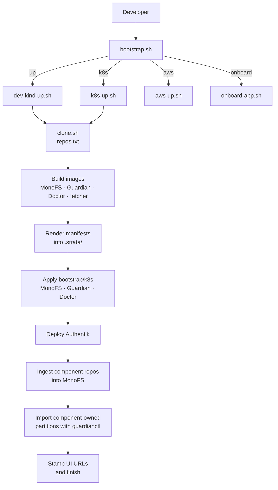
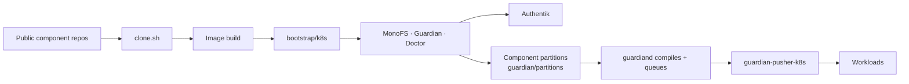

# Bootstrap and Deployment Entry Point

> **Scope:** `strata/` — the public umbrella repository that clones, builds, and bootstraps the platform.
> **Deep references:** [`docs/architecture.md`](../architecture.md), [`docs/local-kind.md`](../local-kind.md), [`docs/kubernetes.md`](../kubernetes.md), [`docs/aws.md`](../aws.md).

`strata/` is the public front door. It contains no engines: it holds the bootstrap scripts, reference manifests, example applications, and cross-component documentation that tie the component repositories together.

## Public Repository Map

| Repository | Language | Role |
| --- | --- | --- |
| `monofs` | Go | Distributed filesystem and source plane. |
| `sqlagregator` | Go | Federated SQL coordinator consumed by MonoFS. |
| `guardian` | Go | Declarative deployment control plane. |
| `doctor` | Go | Privacy-first telemetry backend. |
| `agent` | Python | Assistance plane. |
| `lb` | Go | L4 registry and TCP proxy. |
| `kvs` | Go | Embedded versioned KV backing Guardian and MonoFS. |
| `cfg` | Go | Two-tier versioned configuration. |
| `packager` | Go | Encrypted object-store archives. |
| `tlsx` | Go | Shared TLS/mTLS and PKI toolkit. |
| `k8s-top` | Go | Kubernetes metrics exporter. |
| `aws` | TypeScript | CDK deployment of MonoFS/Guardian/Doctor to ECS Fargate. |
| `strata` | Shell | This repository: bootstrap and documentation. |

## Repository Layout

```text
strata/
  bootstrap/
    kind/cluster.yaml          kind cluster definition
    k8s/                       reference control-plane manifests
    partitions/                prepared application partition templates
    auth/                      development Authentik SSO reference
  examples/
    aws-app/                   sample application for AWS
    multicloud-monitoring/     AWS + GCP + k8s GitOps example
    onboarding-app/            sample onboarding application
  scripts/
    clone.sh                   clone component repositories as siblings
    dev-kind-up.sh             build images, create kind, bootstrap
    k8s-up.sh                  build/push and deploy to a cluster
    aws-up.sh                  deploy the AWS CDK stack
    onboard-app.sh             onboard an application repository
  docs/                        operator guides and architecture
  repos.txt                    component repositories in build order
```

## Bootstrap Flow



### Modes

| Command | Result |
| --- | --- |
| `./scripts/bootstrap.sh up` | Local kind cluster with MonoFS, Guardian, Doctor, Authentik, and platform partitions. |
| `./scripts/bootstrap.sh k8s --build --push` | Same stack on the current kubeconfig, using `STRATA_IMAGE_PREFIX`. |
| `./scripts/bootstrap.sh aws --with-pusher -y` | AWS CDK stack: MonoFS router/server/fetcher, Guardian, Doctor, optional AWS pusher. |
| `./scripts/bootstrap.sh onboard --repo ../my-app` | Pushes or registers an application's `guardian/partitions/<name>` bundle. |

### Local URLs (kind)

| URL | Service |
| --- | --- |
| `http://127.0.0.1:28090` | Guardian UI |
| `http://127.0.0.1:28080` | Doctor UI |
| `http://127.0.0.1:28081` | MonoFS UI |
| `http://127.0.0.1:29020` | Authentik |
| `http://127.0.0.1:18088` | Example application |

Guardian, Doctor, and MonoFS all authenticate through Authentik and redirect anonymous browsers to login. The development Authentik admin is `akadmin` / `password`, and the bootstrap grants it platform admin once the policy bundle is published.

## What Bootstrap Actually Deploys

`bootstrap/k8s` starts the three core planes directly:

| Manifest | Workloads |
| --- | --- |
| `10-monofs.yaml` | `monofs-server` (metadata + embedded Raft KVS), `monofs-router`, `monofs-logquery`. |
| `10-monofs-fetcher.yaml` | `monofs-fetcher` (content + Git sync). |
| `20-guardian.yaml` | `guardiand`, `guardian-pusher-k8s`, service account/RBAC. |
| `30-doctor.yaml` | `doctor-ingest`, `doctor-query`. |

Component-owned partitions (`monofs/guardian/partitions`, `guardian/guardian/partitions`, `doctor/guardian/partitions`, and the Agent's `guardian/` config) observe the bootstrap workloads and add probes rather than creating duplicates. LB and Agent are deployed from their own repositories.

The checked-in manifests use placeholders — `__APP_IMAGE__`, `__IMAGE_PREFIX__`, `__IMAGE_TAG__`, `__NAMESPACE__`. Scripts render them into `.strata/`; the checked-in files are never modified.



## Build from Source

`clone.sh` reads `repos.txt` and clones each component as a sibling directory. Go modules use `replace` directives to those siblings, so the layout matters:

```text
strata/
monofs/
sqlagregator/     # required by monofs; currently cloned separately
guardian/
doctor/
agent/
lb/
kvs/
cfg/
packager/
aws/
k8s-top/
```

Recommended build order (from `repos.txt`):

```text
kvs → cfg → packager → monofs → guardian → doctor → agent → lb → k8s-top → aws
```

`tlsx` and other shared modules resolve from the Go module proxy unless a local sibling checkout is used for development.

Each component is versioned independently with semantic tags and a GitHub release. `repos.txt` defines build order, not a lockstep version set; images are built from the cloned source, so a deployment is reproducible from the checkout.

## Notable Details

- Bootstrap starts only the core planes; LB and Agent are deployed from their own repositories.
- The checked-in manifests are templates. All environment-specific values are rendered at bootstrap time.
- Component partitions are self-owned: each public repo carries its own `guardian/partitions` (or Agent `guardian/`) config, so a component change can update its deployment without touching the umbrella repo.
- The AWS path uses the public `aws` CDK project; the GCP path uses the Guardian GCP pusher's embedded blueprints (see [cloud-deployment.md](cloud-deployment.md)).
- `clone.sh` is idempotent; `dev-kind-up.sh` calls it automatically if siblings are missing.

## Source Map

| Read next | Path |
| --- | --- |
| Architecture | `strata/docs/architecture.md` |
| Bootstrap | `strata/scripts/bootstrap.sh`, `strata/scripts/dev-kind-up.sh` |
| Manifests | `strata/bootstrap/k8s/`, `strata/bootstrap/partitions/` |
| Auth | `strata/bootstrap/auth/`, `strata/docs/access-and-login.md` |
| Examples | `strata/examples/` |
| Build order | `strata/repos.txt`, `strata/scripts/clone.sh` |
