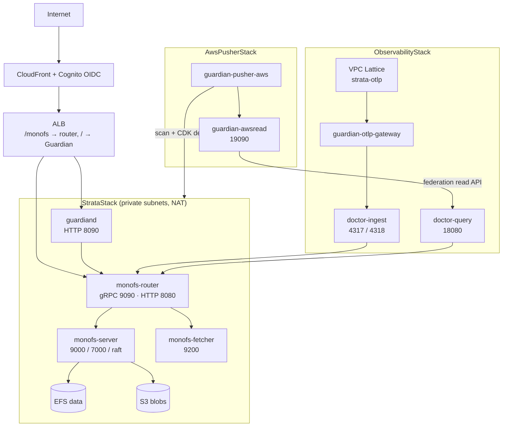
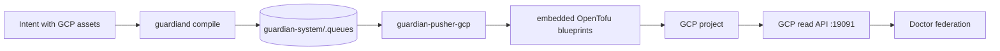
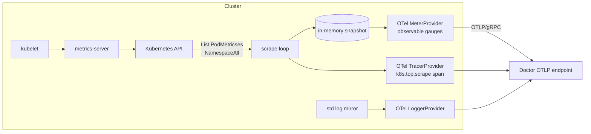
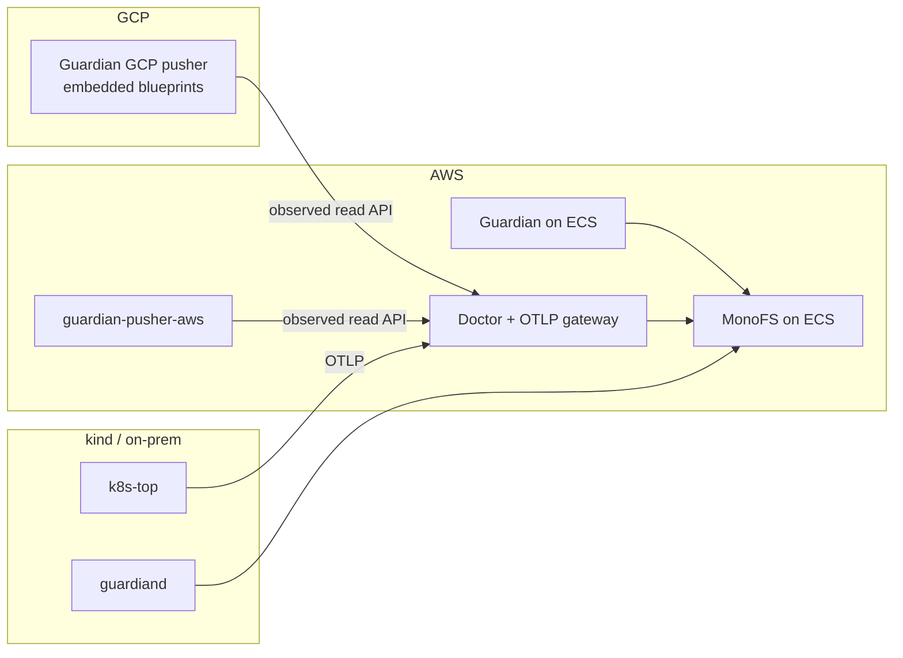

# Cloud Deployment and Cluster Metrics

> **Scope:** `aws/` (CDK → ECS Fargate) and `k8s-top/` (cluster metrics exporter).
> **Deep references:** [`aws/README.md`](https://github.com/radryc/aws/blob/main/README.md), [`k8s-top/README.md`](https://github.com/radryc/k8s-top/blob/main/README.md).

These projects extend the platform beyond a single kind cluster: AWS runs MonoFS, Guardian, and Doctor on ECS Fargate; Guardian's GCP pusher applies embedded OpenTofu blueprints; `k8s-top` turns Kubernetes resource usage into Guardian-attributed OTLP telemetry.

## AWS — CDK on ECS Fargate

`aws/` is a standalone TypeScript CDK project. Dockerfiles fetch pinned public source revisions at build time, so no sibling checkout is needed.

### Stacks and constructs

| Stack | File | Role |
| --- | --- | --- |
| `StrataStack` | `lib/strata-stack.ts` | VPC, ECS Fargate services, EFS, S3, ALB, CloudFront, Cognito, Service Connect DNS `strata.local`. |
| `ObservabilityStack` | `lib/observability-stack.ts` | `doctor-ingest`, `doctor-query`, `guardian-otlp-gateway`, VPC Lattice service network `strata-observability`, optional AWS RAM share. |
| `AwsPusherStack` | `lib/aws-pusher-stack.ts` | Account scan, CDK deploy driver, read API `guardian-awsread:19090`. |
| `AwsPusherFleetStack` | `lib/aws-pusher-fleet-stack.ts` | Multi-account pusher fleet. |
| `AwsObservedPusherStack` | `lib/aws-observed-pusher-stack.ts` | Report-only observed-resource pusher. |
| `DemoStack` / `ClientVpnStack` | `lib/demo-stack.ts`, `lib/client-vpn-stack.ts` | Sample workload and operator access. |

Reusable CDK constructs live in `aws/templates/aws/v1/`: `network.vpc`, `compute.fargate`, `volume.efs`, `objectstore.s3`, `database.aurora-*`, `loadbalancer.alb`, `loadbalancer.nlb`. Guardian-oriented helpers are in `aws/lib/guardian-constructs/`, `guardian-observe.ts`, `sentinel-alarms.ts`, and `docker-assets.ts`.

### Deployment entry points

- `aws/bin/strata.ts` instantiates the stacks; `cdk.json` holds context.
- `npm run synth|diff|deploy`; `npm run bootstrap` once per account/region.
- `deploy.sh` wraps the common deployments; `wipe.sh` tears down.
- Image sources are pinned with `ARG *_REF` in `aws/docker/*.Dockerfile`; override per build with `--build-arg`.
- `deploySSO`, `demoUserPassword`, `deployObservability`, `deployAwsPusher` context flags control optional planes.

## GCP — Guardian pusher blueprints

GCP infrastructure is deployed by Guardian's public GCP pusher (`guardian/internal/pusher/drivers/gcp/`), not by a separate project. The pusher renders embedded OpenTofu/Terraform blueprints into per-intent payloads for networking, compute, GCS, Secret Manager, Cloud SQL, persistent disks, load balancing, and observability, then applies them with OpenTofu. It also exposes a read API for report-only observation (`gcpobserve`).

## k8s-top — Guardian-attributed cluster metrics

`k8s-top` is a read-only, cluster-wide poller. It calls `metrics.k8s.io` and exports OTLP; it never writes to Kubernetes and keeps no local persistence.

### Cadences

| Loop | Default | Behavior |
| --- | --- | --- |
| Poll | `K8S_TOP_POLL_INTERVAL=15s` | `MetricsV1beta1().PodMetricses(NamespaceAll).List()`, aggregate container usage to pod totals, sort by namespace/pod/container, replace the snapshot. Each poll is a `k8s.top.scrape` span. |
| Metric export | `K8S_TOP_OTEL_METRIC_INTERVAL=15s` | Periodic reader observes gauges from the latest successful snapshot. Before the first success, no gauges are exported. |

### Instruments (`meter scope: k8s.top`)

| Metric | Type | Notes |
| --- | --- | --- |
| `k8s.top.scrape.executions` | counter | Scrapes attempted. |
| `k8s.top.scrape.failures` | counter | Scrapes that failed; also emits an OTLP error log. |
| `k8s.top.scrape.duration.seconds` | histogram | Scrape latency. |
| `k8s.top.observed.pods` / `.containers` | gauge | Size of the last successful snapshot. |
| `k8s.top.scrape.last_success_unix` | gauge | Freshness. |
| `k8s.top.pod.cpu.usage.millicores` / `.memory.usage.bytes` | gauge | Pod totals. |
| `k8s.top.container.cpu.usage.millicores` / `.memory.usage.bytes` | gauge | Container usage. |

Pod labels `guardian.partition`, `guardian.intent`, `guardian.asset`, `guardian.asset.type` (fallback `guardian.type`) become `guardian.target.*` attributes. This is what lets Doctor answer "which Guardian asset is consuming CPU?" rather than only "which pod?".

The scrape span carries observed namespace/pod/container counts and duration; the busiest CPU and memory containers are added as `top-cpu-container` / `top-memory-container` span events.

## Cross-Provider Integration

MonoFS remains the shared store even when it runs on AWS. Doctor federates AWS CloudWatch/X-Ray and GCP Monitoring/Logging/Trace from pusher read APIs; the Guardian pusher drivers (`internal/pusher/drivers/{aws,gcp,kubernetes}`) are the only components that mutate cloud state.

## Notable Details

- AWS service discovery is Service Connect (`strata.local`), not a hand-maintained DNS zone.
- Doctor on AWS is fronted by CloudFront + Cognito when `deploySSO=true`; in-cluster deployments use OIDC/Authentik instead.
- The AWS pusher read API is an observability contract, not a deployment channel: it exposes inventory and status only.
- GCP is driven entirely by the Guardian pusher's embedded blueprints; there is no standalone GCP deployment project in this documentation set.
- `k8s-top` is deliberately single-replica and stateless; metric gaps are visible through `last_success_unix` rather than buffered.

## Source Map

| Read next | Path |
| --- | --- |
| AWS entry | `aws/bin/strata.ts`, `aws/lib/strata-stack.ts`, `aws/lib/observability-stack.ts`, `aws/lib/aws-pusher-stack.ts` |
| AWS constructs | `aws/templates/aws/v1/`, `aws/lib/guardian-constructs/` |
| AWS images | `aws/docker/*.Dockerfile`, `aws/deploy.sh` |
| GCP pusher | `guardian/internal/pusher/drivers/gcp/` |
| Pusher drivers | `guardian/internal/pusher/drivers/{aws,gcp,kubernetes}/` |
| k8s-top | `k8s-top/cmd/k8s-top/main.go`, `internal/scrape/`, `internal/telemetry/` |
