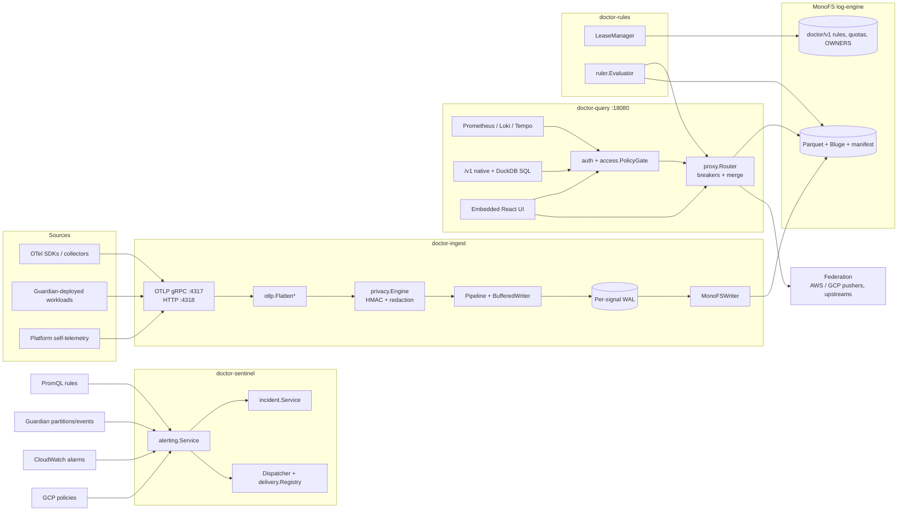
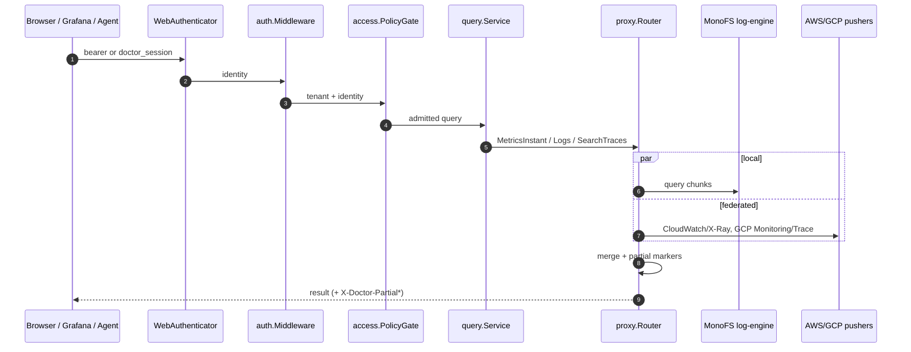

# Doctor — Observability Plane Architecture

> **Scope:** `doctor/` — OTLP ingest, privacy pipeline, MonoFS log-engine storage, Prometheus/Loki/Tempo query compatibility, federation, rules, and Sentinel alerting.
> **Deep references:** [`doctor/docs/architecture/overview.md`](https://github.com/radryc/doctor/blob/main/docs/architecture/overview.md), [`components.md`](https://github.com/radryc/doctor/blob/main/docs/architecture/components.md), [`data-model.md`](https://github.com/radryc/doctor/blob/main/docs/architecture/data-model.md).

Doctor is the observability plane. It accepts OpenTelemetry over OTLP, tokenizes sensitive fields **before** persistence, writes chunks through MonoFS log-engine, and serves native, Prometheus, Loki, and Tempo APIs from one query surface. It has no segment format or database of its own: MonoFS is the store.

## Component topology

One image builds one binary selected by `DOCTOR_SERVICE`; `doctor-query` is the main API/UI service.

## Key Components

| Binary | Code home | Responsibility |
| --- | --- | --- |
| `doctor-ingest` | `cmd/doctor-ingest`, `internal/ingest`, `internal/otlp`, `internal/privacy`, `internal/wal`, `internal/store/monofs` | OTLP receive, flatten, anonymize, durable buffer, write to MonoFS log-engine. |
| `doctor-query` | `cmd/doctor-query`, `internal/query`, `internal/proxy` | Native + compatibility APIs, UI host, federation router, Guardian health proxy. |
| `doctor-rules` | `cmd/doctor-rules`, `internal/ruler` | Leader-elected recording-rule evaluation and rule API. |
| `doctor-sentinel` | `cmd/doctor-sentinel`, `internal/alerting`, `internal/delivery`, `internal/incident` | Alert rules, sources, dedupe/fingerprint, incidents, notification delivery. |
| `doctor-loadgen` | `cmd/doctor-loadgen` | Ingest/query/HTTP load generation. |
| Federation CLIs | `cmd/doctor-federation-{build,publish,controller}`, `internal/federation` | Build/publish sharded catalog snapshots and token shards; leader-elected controller. |
| Frontend | `frontend/src/` (React 19 + Vite + ECharts) | Dashboards, services, traces, logs, metrics, fleet/partitions, rules, alerts, incidents, probes, federation, quota, SQL. Embedded with `//go:embed ui/dist` in `internal/query/ui.go`. |

## How It Works

### 1. Ingest is a one-way privacy funnel

`ingest.Service` exposes `traceServer/logsServer/metricsServer.Export` plus `handleHTTP*`. HTTP JSON IDs are normalized from hex to base64 (`normalizeOTLPJSONIDs`) before `protojson` decoding; protobuf uses `proto.Unmarshal`. Every decoded request then follows the same path:

1. **Flatten** — `otlp.FlattenTraces/FlattenLogs/FlattenMetrics` converts OTLP into `segment.TraceRecord`, `segment.LogRecord`, `segment.MetricPointRecord`, canonicalizing resource identity to `<partition>.<intent>.<asset>`.
2. **Sanitize** — `privacy.Engine` redacts secret-looking keys/values, HMAC-SHA256 tokenizes identity-like keys into `tok_…`, tokenizes emails/IPs in free text, keeps only allowlisted identity attributes, and drops links, scope, and most exemplars.
3. **Admit** — `quota.Engine` checks partition storage/ingest-rate budgets; `auth.NewMiddleware` + `authz.NewAuthenticator` resolve tenant from `x-doctor-tenant` (gRPC metadata or HTTP header), then `DOCTOR_DEFAULT_TENANT`, then `default`.
4. **Buffer** — `Pipeline` is a bounded queue + worker pool. Synchronous submit returns `ErrQueueFull`/`ErrBufferFull`, mapped to HTTP `429` or gRPC `ResourceExhausted`. `BufferedWriter` persists per-signal batches through `wal.TraceBatchLog`/`LogBatchLog`/`MetricBatchLog` (length-prefixed JSON frames with `fsync`, interval/size flush, boot replay).
5. **Write** — background flushes call `MonoFSWriter`, which invokes `LogEngineClient.IngestTraces/IngestLogs/IngestMetrics` with timestamp-derived chunk IDs. `WriteGuardianEvents` intentionally returns `ErrGuardianEventsUnsupported` (HTTP 501); Guardian events are read from Guardian, not ingested.

Guardian identity labels are merged into resource attributes, so telemetry is attributable to a partition/intent/asset rather than only a pod name.

### 2. Query is a single authorized fan-out

`query.Service` registers one mux (`Handler()`):

- **Prometheus** `/api/v1/*` — `prometheus_compat.go` implements a custom `storage.Queryable`/`Querier` executed by the upstream PromQL engine. `prometheus_count_by_name.go` answers `count by (__name__)` from `series_index.go`; `prometheus_guard.go` rejects all-series ranges longer than 15 minutes; budgets return `422`.
- **Loki** `/loki/api/v1/*` — `parseLokiPlan` compiles stream selectors and line filters, pushes only those to storage, then evaluates parser stages and metric queries locally with a bounded label allowlist.
- **Tempo** `/api/*` — trace-by-ID (protobuf or JSON), a TraceQL search subset, TraceQL metrics with caps, and magic IDs (`latest`, `latest-service:<prefix>`).
- **Native** `/v1/*` — span search, recent traces, log services/search, metric range, DuckDB SQL console (`POST /v1/sql/query`), service discovery, dashboards, federation status, and Guardian topology/events/health/probes proxies.
- **UI** `/` — embedded SPA with SPA fallback that refuses HTML for API prefixes (`api/`, `v1/`, `loki/`, …).

`doctor-query/main.go` wires `proxy.NewRouter` as the execution path. The router performs access decisions, bounded fan-out, per-backend circuit breaking, timeout, and local-first merge (`merge_{metrics,logs,traces}.go`). Backends are the local MonoFS log-engine (`LocalMetrics/Logs/TracesUpstream`), AWS/GCP pusher read APIs, and optional static upstreams (Prometheus, Loki, Tempo, Elasticsearch, BigQuery). `querFlightGroup` coalesces identical PromQL queries and `cachingBackend`/`resultCache` cache reads.

Federation is both catalog-driven and discovery-driven: `federation.Manager`/`Planner` plan shards, `federation.Controller` publishes AES-GCM token shards plus snapshots to MonoFS (manifest is the commit point), and `proxy.NewGuardianDiscovery` adds Guardian-managed AWS/GCP pushers dynamically.

### 3. Rules and alerting are separate leaders

`doctor-rules` wires `ruler.Store`, `ruler.Evaluator` (HTTP PromQL against `doctor-query`, results written back through MonoFS), `ruler.Scheduler`, and `ruler.LeaseManager`. Rules are YAML at `/doctor/v1/rules/<partition>/<group>.yaml`; a CAS lease (`TTL 30s`, renew `10s`) elects one evaluator and followers idle. `ScopedRulesAuthorizer` restricts partition tokens to their own rule groups.

`doctor-sentinel` owns alert state: `alerting.Store`/`Service`, `alerting.RuleScheduler` behind its own lease, `alerting.Dispatcher` + `delivery.Registry` (webhook, Slack, Teams, Zoom, PagerDuty, Android, FCB), and `incident.Service/API`. Alert sources are PromQL rules, `GuardianSource` (maps `/api/partitions` state to `GuardianPartitionError/Attention/Unavailable` with per-partition policy), `AWSSource` (CloudWatch alarms), and `GCPSource` (GCP alert policies). Alerts are fingerprinted and deduplicated; the API exposes `/v1/alerts*` plus a read-only Alertmanager `/api/v2/*` surface.

### 4. Access control is the Strata Access bundle

`access.PolicyGate` loads the compiled Strata Access policy (published by Guardian at `/api/access/policy`) and applies `FilterLogs`, `FilterSpans`, `VisiblePartitions`, `CanSeePartition`, and middleware. Metrics are globally visible; logs and traces are partition-filtered; the tenant is a label, not an isolation boundary. Legacy endpoint ACLs (`Owners`/`Static`/`Grants`/`Chain`) still exist for older routes. `DOCTOR_ACCESS_MODE=enforce` makes filtering mandatory.

## State Ownership and Failure Modes

| State | Owner | Notes |
| --- | --- | --- |
| Telemetry chunks | MonoFS log-engine | Parquet data + Bluge index + manifest; compaction (`compactor.go`, `monofs-logengine-compact`) and retention (`RunRetention`) live in MonoFS. |
| Ingest buffer | Local WAL | Per-signal JSON frames, `fsync` on flush, replayed at boot; overflow is rejected, never silently dropped. |
| Rules, quotas, leases | MonoFS `doctor/v1` | CAS leases; no external database. |
| Alerts, silences, incidents | Sentinel store | Fingerprinted; delivery is at-least-once with retry. |
| Federation catalog | MonoFS snapshots | Manifest is the commit point; token shards are AES-GCM encrypted. |

| Failure | Behavior |
| --- | --- |
| MonoFS unavailable | WAL keeps accepting until full; then 429/`ResourceExhausted`. Query returns errors from the local backend and fans out to federated backends where possible. |
| Federated backend down | Per-backend circuit breaker removes it from fan-out; responses are marked partial. |
| Query budget exceeded | `422` with budget details rather than unbounded scans. |
| Rules leader lost | Lease expiry (30s) lets another replica take over; followers do not evaluate. |
| OIDC outage | Cached JWKS continues verification until refresh is required; break-glass verifier exists. |

## Notable Details

- There is **no `doctor` binary**; `doctor-query` is the main service and hosts the UI.
- The log-engine mapping is intentionally lossy: tenant/kind/events/severity-number are dropped or canonicalized into the preserved fields.
- `/api/v1/rules` deliberately returns an empty rule list for Prometheus compatibility; rules live under Doctor's own API.
- All three compatibility surfaces share one auth gate, so Grafana, the Agent, and the UI see the same partition filtering.
- Ingest accepts 256 MB gRPC messages and 10 MB HTTP bodies; HTTP ingest returns `202` on accept.
- The UI is compiled into the binary with `go:embed`, so `doctor-query` is the only artifact needed to serve the frontend.

## Source Map

| Read next | Path |
| --- | --- |
| Ingest | `doctor/cmd/doctor-ingest`, `doctor/internal/ingest`, `doctor/internal/otlp`, `doctor/internal/privacy`, `doctor/internal/wal` |
| Query + compat | `doctor/internal/query`, `doctor/internal/proxy`, `doctor/internal/tempo` |
| Federation | `doctor/internal/federation`, `doctor/internal/store/{aws,gcp}`, `doctor/cmd/doctor-federation-*` |
| Rules | `doctor/internal/ruler`, `doctor/cmd/doctor-rules` |
| Alerts | `doctor/internal/alerting`, `doctor/internal/incident`, `doctor/internal/delivery` |
| Auth/access | `doctor/internal/auth`, `doctor/internal/access`, `doctor/internal/identity` |
| UI | `doctor/frontend/src`, `doctor/internal/query/ui.go` |
| Deployment | `doctor/deploy` |
