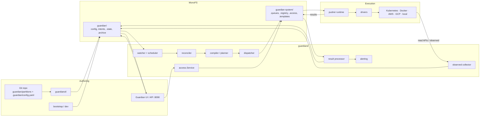
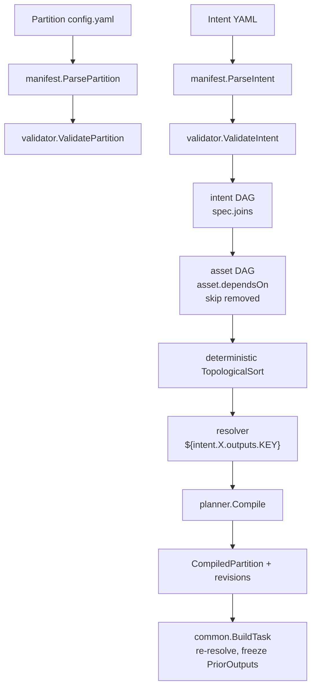
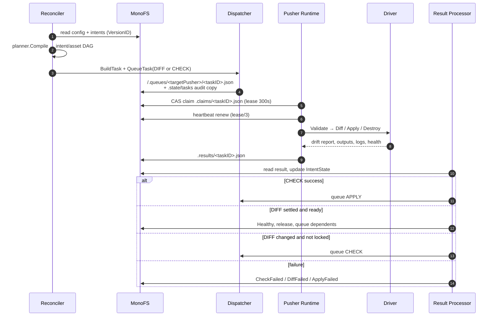

# Guardian — Deployment Control Plane Architecture

> **Scope:** `guardian/` — `guardiand`, `guardianctl`, pusher workers, compiler/planner, orchestrator, queue, drivers, UI/API, access, and provider integrations.
> **Deep references:** [`guardian/docs/architecture.md`](https://github.com/radryc/guardian/blob/main/docs/architecture.md), [`logical-flow.md`](https://github.com/radryc/guardian/blob/main/docs/logical-flow.md), [`codebase-map.md`](https://github.com/radryc/guardian/blob/main/docs/codebase-map.md).

Guardian is an asynchronous, intent-based deployment control plane. Desired state lives in MonoFS as partitions and intents; Guardian compiles them into typed assets, computes drift, queues tasks, and lets pusher workers execute `DIFF → CHECK → APPLY` (or `DESTROY`) against Kubernetes, Docker, AWS, GCP, or a local backend.

Guardian has **no database and no inbound deployment channel**. MonoFS is both the store and the message bus: versioned reads, CAS writes, file leases, and watch events replace transactions and a queue service.

## System Context

## Key Components

| Binary | Code home | Responsibility |
| --- | --- | --- |
| `guardiand` | `cmd/guardiand/main.go` | Composition root: reconciler, partition watcher, dispatcher, result processor, observed collector, alerting, onboarding, access policy, UI/API. Opens the MonoFS store via `internal/store/monofs.Open`; runs loops with `run(name, fn)` and graceful shutdown. |
| `guardianctl` | `cmd/guardianctl/*.go` | Operator CLI: `partition push/reconcile/delete/status/rollout`, `intent`, `asset`, `repo`, `sets`, `pusher`, `aws`, `gcp`, `image`, `release`, `access`, `audit`, `dev`, `auth`. Writes directly to MonoFS. |
| `guardian-pusher-k8s` | `cmd/guardian-pusher-k8s`, `internal/pusher/drivers/kubernetes` | Kubernetes worker; client-go server-side apply (`Force:true`) or kubectl; optional read API (`k8sread`). |
| `guardian-pusher-docker` | `cmd/guardian-pusher-docker`, `.../drivers/docker` | Docker worker over the host socket/state dir. |
| `guardian-pusher-aws` | `cmd/guardian-pusher-aws`, `.../drivers/aws` | AWS worker: composite CDK + native SDK backend, account/region `CanHandle`, scan runner, observed SQS consumer, read API `:19090`, `--observed-only`. |
| `guardian-pusher-gcp` | `cmd/guardian-pusher-gcp`, `.../drivers/gcp` | GCP worker: OpenTofu with embedded HCL blueprints, Cloud Asset Inventory observation, read API `:19091`. |
| `guardian-pusher-local` | `cmd/guardian-pusher-local` | In-process reference drivers (compute, database, probe) for tests/demos. |
| `guardian-docker` | `cmd/guardian-docker` | Standalone Docker inspect/diff helper for Guardian-labelled resources. |
| `forge` / `audit-anchor` | `cmd/forge`, `cmd/audit-anchor` | Repository authoring/PR workbench; offline audit-anchor verification. |

Packages: `internal/compiler/{manifest,validator,planner,dag,resolver,values}`, `internal/domain/{partition,intent,asset,assets,state,task,release,target,history}`, `internal/orchestrator/{reconciler,dispatcher,results,watcher,common}`, `internal/store/{fs,memory,monofs}`, `internal/pusher/{runtime,registry,drivers,probes,secrets}`, `internal/ui`, `internal/access`, `internal/aws*`, `internal/gcp*`, `internal/k8s*`, `internal/cdkgen`, `internal/observed*`, `internal/alerting`, `internal/notify`.

## Desired State and Compilation

### Model

- **Partition** — the deployment unit; `config.yaml` with `apiVersion: guardian/v1alpha1`, schedule, deletion policy, sets, and context.
- **Intent** — one deployable concern with `joins` to other intents and a list of typed **assets**.
- **Asset** — a concrete resource (`Compute`, `ImageBuild`, `Volume`, `Database`, `Network`, `LoadBalancer`, `ObjectStore`, `Config`, `Secret`, `CDKStack`, `Observability`, …) with `dependsOn`.

### Compile

`Reconciler.reconcilePartition` reads `paths.PartitionConfig` and `paths.PartitionIntentsDir`, capturing each `FileInfo.VersionID`, then calls `planner.Compile(CompileInput{ConfigContent, IntentContents, IntentVersionIDs, CurrentOutputs})`. The result is a `CompiledPartition{PartitionRevision, IntentOrder, Intents map[string]*CompiledIntent}`; each intent carries `Spec`, `IntentVersionID`, `IntentSpecHash`, `AssetVersionIDs`, `AssetOrder`, and `OutputRefs`.

- Output references are exactly `${intent.<name>.outputs.<key>}` (`internal/compiler/resolver`). Unresolved refs are deferred, not failed.
- `${value.NAME}` is partition-scoped via `internal/compiler/values`.
- Driver-local outputs are addressed as `in.Outputs[assetName+".key"]`.
- CDK intents get a synthetic `GeneratedStack`; `internal/cdkgen` renders a TypeScript app under `payloads/aws-generated/<intent>/`. A generation failure blocks only that intent.
- Revisions (`AssetVersionID`, `PartitionRevision`, `DeploymentRevisionID`) come from `internal/versioning/revisions`.

## Reconcile Lifecycle

### Operation choice

`Reconciler.reconcilePartition` picks the next operation:

| Condition | Operation |
| --- | --- |
| Default / no drift evidence | `DIFF` |
| `LastAppliedSpecHash != IntentSpecHash`, status `Drifted`, `ApplyFailed`, or `CheckFailed` | `CHECK` |
| Forced reconcile / `ForceApplyPartition` | `APPLY` |
| Partition `disabled` | no tasks (`Disabled` state) |
| Partition `manual` | compile only; queue only when forced |
| Deletion record present, `deletionPolicy: destroy` | `DESTROY` from archived/live manifests |

`OpApply` is normally reached only from a successful `CHECK`. Tasks are built by `common.BuildTask`/`BuildTaskFromManifest`, which re-parses raw YAML, re-resolves outputs, removes skipped assets, substitutes `GeneratedStack`, and freezes `PriorOutputs` to avoid TOCTOU.

### End-to-end sequence

### Result semantics

- `CHECK` success queues `APPLY` unless the intent is `Observed`.
- `DIFF` success: observed → `Observed`/`ObservedDrifted`; settled and ready → `Healthy` + `queueDependents`; settled but not ready → re-queue `DIFF`; locked/readonly → `DriftedLocked`; changed → queue `CHECK`.
- `APPLY` success → `Healthy`, archive deployment, write release, queue dependents; not settled → re-queue `DIFF`.
- Failures record `rollbackTo`/`rollbackReason` and preserve the manifest for retry.
- If the spec changes while a task is in flight, the reconciler re-queues `DIFF`/`CHECK` instead of accepting a stale rollout.

### DESTROY

`internal/orchestrator/reconciler/deletion.go` handles `.deletion.json`. `deletionPolicy: destroy` builds `OpDestroy` tasks from archived/live manifests and purges only after every intent is `Destroyed`; `orphan` drops state and purges immediately. Task/claim artifacts are cleaned up by the control plane.

## Task Queue and Claims

There is no queue service. Queue paths are in `internal/paths/paths.go` (`QueueDir`, `QueueTask`, `QueueClaim`, `QueueResult`).

- `Dispatcher.QueueTask` writes `/.queues/<TargetPusher>/<taskID>.json` plus an immutable `.state/tasks` audit copy with a hash chain.
- `targetPusher` is both placement selector and queue directory.
- Pushers self-register into `/.registry/pushers/<name>.json` with `PusherInfo` (account, region, capabilities, observed read URL).
- `tryClaimTaskWithLease` creates a `ClaimFile` with `ExpectedVersionID:"absent"` (CAS) and a 300-second lease; `startClaimHeartbeat` renews at lease/3; `claimExpired` allows takeover.
- The runtime polls every 5s and optionally watches; `CanHandle` filters by account/region/target; optional task-ID sharding.
- Results are written once, with no retry/CAS. A lost result write is recovered only by stale-task timeout (`Guardian.StaleTaskAfter`, default 30m) and the `.results` watcher/rescan.

## Pusher Drivers

`Runtime.executeTask` iterates assets in order (reversed for DESTROY), resolves drivers through `registry.Registry`, and blocks `APPLY` assets whose dependencies are unhealthy.

| Family | Behavior |
| --- | --- |
| Docker | Ownership labels, container/network/volume names, host socket. |
| Kubernetes | `guardian.*` labels/annotations, client-go `Force:true` server-side apply or kubectl; ensures target namespace exists; Volume drift ignores an unpinned default storage class. |
| AWS native / CDK | SDK/CloudFormation service calls; `GeneratedStackDriver` stages generated TypeScript and runs `cdk synth/deploy`. |
| GCP | OpenTofu workspaces (`opentofu.Runner`, `flock` locking) over embedded blueprints, plus Secret Manager and an observer. |
| Local | In-memory reference drivers for tests/demos. |

Drivers return drift details, health, outputs, and logs. `driverutil.ApplyOtelEnv` injects `OTEL_SERVICE_NAME`/`OTEL_RESOURCE_ATTRIBUTES` and topology tags so deployed workloads report as `<partition>.<intent>.<asset>`.

## API, UI, and Auth

When `guardian.uiListenAddress` is set (commonly `:8090`), `internal/ui.Server.routes` serves:

- **Meta:** `/health`, `/api/v1/status/buildinfo`, `/api/catalog`, `/api/me`, `/api/overview`.
- **Client/access:** `/api/client-config`, `/api/access/policy`, `/api/access/explain`.
- **Partitions:** `/api/partitions`, `/api/partitions/{name}` plus `topology`, `rollouts`, `history`, `validate`, `reconcile`, `intents/{i}/activity`.
- **Operations:** scans, pushers, repos, sets, probes, observability, unmanaged, display profiles.
- **M2M:** `/api/m2m/overview`, `/api/m2m/partitions*`, `/api/m2m/pushers*`, `/api/m2m/federation/partitions`.

The UI is an embedded vanilla TypeScript SPA (`internal/ui/static-src/`; `internal/ui/data.go` is the read model). Guardian exposes **no gRPC server**; its gRPC usage is the MonoFS client. Pusher read APIs are HTTP (`/v1/aws/*`, `/v1/gcp/*`, `/v1/k8s/*`).

Auth is layered: `coreauthz.NewOIDCVerifier` + `NewAuthenticator(...).HTTPMiddleware`, then UI `checkUIAuth` (anonymous mutations rejected unless the loopback escape hatch is enabled) and `authorizeMutation` (`access.CanModify` for partition mutations, `access.IsAdmin` for registry/repo/scan/set metadata, `CanModifyAny` for creating a set). M2M uses access-policy tokens. Pusher read APIs use bearer tokens with `read`/`diff`/`admin` scopes, body/rate limits, and TLS/mTLS.

## Integrations

| System | Integration |
| --- | --- |
| **MonoFS** | `pkg/guardianapi.Store` implemented by `internal/store/{fs,memory,monofs}`. `monofs.Adapter` maps logical paths to `guardian/` (desired state) and `guardian-system/` (`.queues`, `.archive`, `.scans`, `.registry`, `.access`, `.display`, `.templates`). Versioned reads (`ReadPathVersioned`, `GetVersion`) + `Watch` + polling. |
| **Doctor** | OTLP traces/metrics/logs via `internal/telemetry`; `internal/observability.CanonicalServiceIdentity` builds `<partition>.<intent>.<asset>`; `internal/display` compiles a versioned display bundle. Guardian emits self-telemetry and deployment events; Doctor reads its API for health/topology. |
| **lb-edge** | `LoadBalancer` assets (listeners, `externalPort`, `dynamic`) deploy an lb-edge container with `LB_BOOTSTRAP=<port>=host:port`. Guardian records `address`/`dns_name`/`lb_arn` outputs in `IntentState.Outputs`; the `lb/` registry owns live endpoint registration. |
| **Access** | `internal/access.Service` compiles repo ACLs + catalog into `/.access/compiled/policy.json`, serving `CanSee`, `CanModify`, `CanModifyAny`, `IsAdmin`, `AuthorizeModify`, `FilterPartitions`, `PolicyJSON`. Modes disabled/observe/enforce; fail-closed when enforcing without a policy. Repo `access.yaml` validated by `internal/access/partition.go`. |
| **Repos/GitOps** | `internal/repoimport` maps `guardian/partitions/**` into `/partitions/**` with an ownership manifest; `internal/workspacepub` publishes branches through MonoFS; `internal/repoconfig` applies `.guardian/config.yaml`. |
| **Cloud observation** | `internal/{awsobserve,gcpobserve,k8sobserve}` + `internal/observed` write report-only `.observed` snapshots; they never queue tasks. `internal/awsscan`/`gcpscan` inventory resources; `awsgen` builds adoption-aware drafts. |
| **Alerting** | `internal/alerting` + `internal/notify` send HMAC-signed webhooks on `Failing`/`Invalid` (critical) and `Attention` (warning) with fail threshold, cooldown, repeat, and channel filters. |
| **Compliance** | `internal/compliance` mirrors state/archive to S3. |

## State Machine and Failure Recovery

Runtime state is `statedomain.IntentState`/`PartitionState` under `/partitions/
/.state/`. Statuses include `Diffing`, `Checking`, `Applying`, `Healthy`, `Drifted`, `DriftedLocked`, `Observed`, `ObservedDrifted`, `CheckFailed`, `DiffFailed`, `ApplyFailed`, `Destroying`, `Destroyed`, `Disabled`, `Invalid`, `Attention`, and `Unknown`.

| Failure | Recovery |
| --- | --- |
| Pusher dies mid-task | Claim lease (300s) expires; another pusher reclaims. |
| Result write lost | Stale-task timeout (30m) + `.results` rescan. |
| Store watch missed | 30s discovery/reconcile sweep. |
| Bad intent | Validator rejects; partition surfaces `Invalid` and no tasks are queued. |
| Apply fails | Status `ApplyFailed`; rollback metadata recorded; manifest preserved for retry. |
| Unknown state on startup | Reconciler treats it as drift and queues `DIFF` then `CHECK`. |
| MonoFS unavailable | Control loop errors and retries; pushers keep executing already-claimed tasks. |

## Notable Details

- **Files are the API.** Optimistic concurrency uses MonoFS `VersionID` and CAS (`ExpectedVersionID`, `"absent"`); there are no transactions.
- **Compiled plans are not execution truth.** Tasks re-parse manifests so a stale compiler bug cannot freeze a wrong payload.
- **Reconciler only seeds work.** It queues the initial `DIFF`/`CHECK`; the result processor owns follow-ups and dependency release.
- **`readonly` is `DriftedLocked`.** A locked partition still computes drift but never queues `APPLY`.
- **Observed intents are strictly report-only.** `APPLY` is rejected defensively in both the runtime and the processor.
- **Secrets in flight.** Queue files carry secret values; results/state/UI are redacted (`task/redact.go`), and task archives are HMAC-chained (`GUARDIAN_ARCHIVE_HMAC_KEY`).
- **`guardianctl` bypasses UI policy by design.** It writes directly to MonoFS; the UI/API is the policy-enforcing surface.
- **Two history representations.** `ReleaseRecord` and `DeploymentRecord` overlap; the release log and archive are the durable deployment history.
- **Self-hosting.** `guardian/partitions/guardian` deploys Guardian itself.

## Source Map

| Read next | Path |
| --- | --- |
| Entry + wiring | `guardian/cmd/guardiand/main.go` |
| Compiler | `guardian/internal/compiler/planner`, `validator`, `dag`, `resolver`, `values` |
| Domain | `guardian/internal/domain/`, `internal/domain/assets/` |
| Orchestrator | `guardian/internal/orchestrator/{reconciler,dispatcher,results,watcher}` |
| Queue paths | `guardian/internal/paths/paths.go` |
| Pusher runtime | `guardian/internal/pusher/runtime/`, `internal/pusher/registry/` |
| Drivers | `guardian/internal/pusher/drivers/{kubernetes,docker,aws,gcp,probe}` |
| Store | `guardian/internal/store/monofs/`, `pkg/guardianapi` |
| UI/API | `guardian/internal/ui/` |
| Access | `guardian/internal/access/` |
| Cloud | `guardian/internal/{aws*,gcp*,k8s*,cdkgen,observed*}` |
| Self-hosting | `guardian/guardian/partitions/guardian/` |
