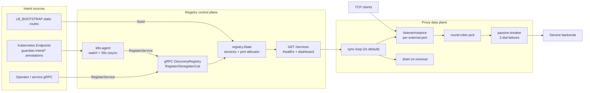
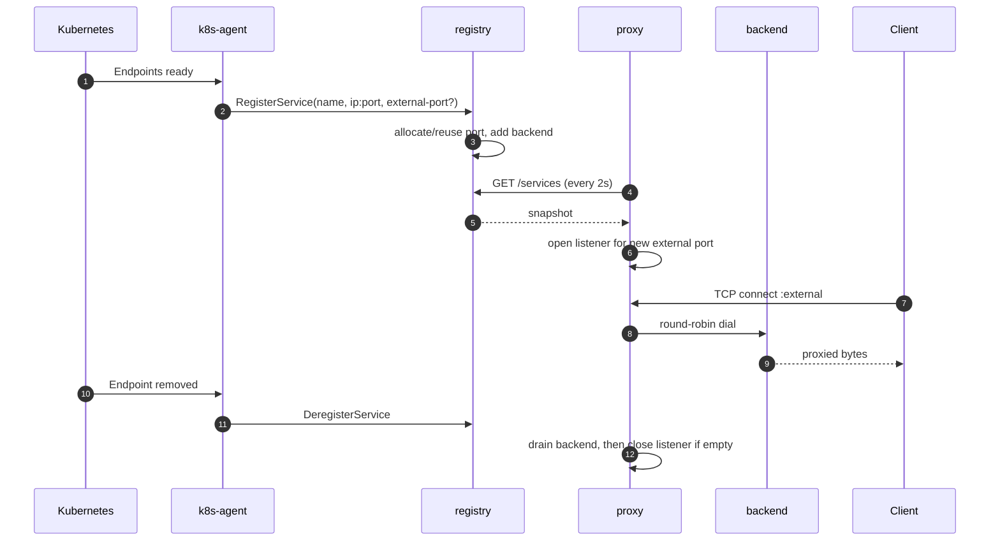

# lb-edge — Traffic Plane Architecture

> **Scope:** `lb/` — the registry control plane, TCP proxy data plane, Kubernetes endpoints agent, and all-in-one edge binary.
> **Deep references:** [`lb/README.md`](https://github.com/radryc/lb/blob/main/README.md), [`lb/AGENTS.md`](https://github.com/radryc/lb/blob/main/AGENTS.md).

lb-edge is the traffic plane: a small L4 registry plus a TCP proxy that follows live backends instead of hand-maintained load-balancer config. It has **no durable state** — the registry is in memory and is reconstructed from Kubernetes Endpoints, static bootstrap routes, and direct gRPC registrations.

## Component topology

Four binaries share one module: `cmd/registry` (control), `cmd/proxy` (data), `cmd/k8s-agent` (intent), and `cmd/edge` (all-in-one, the container default).

## Key Components

| Component | Code home | Responsibility |
| --- | --- | --- |
| Registry state | `pkg/registry/state.go` (`State`, `Register`, `Deregister`, `Seed`, `Snapshot`, `reservePortLocked`) | Service map, used-port set, rotating allocator over the configured range. |
| Registry server | `pkg/registry/server.go` (`GRPCServer`, `BearerAuthUnaryInterceptor`, `HTTPServicesHandlerWithAuth`) | gRPC `DiscoveryRegistry`, HTTP `/services` snapshot, `/healthz`, dashboard. |
| Proxy engine | `pkg/proxy/engine.go` (`Engine`, `listenerInstance`, `syncState`, `startListenerLocked`, `acceptLoop`, `handleConn`, `pickBackend`) | Reconciles listeners and backends from the snapshot. |
| Backend state | `pkg/proxy/backend.go` (`backend`, `stateActive/stateDraining/stateUnhealthy`, `markUnhealthy`, `writeProxyProtocolV1`) | Round-robin, circuit breaking, draining, optional PROXY v1. |
| Kubernetes agent | `pkg/k8sagent/agent.go` (`Agent`, `intent`, `resolveIntent`, `selectPortName`, `parseEndpoints`) | Watches Endpoints, reads intent annotations, registers ready addresses. |
| Edge binary | `cmd/edge` (`seedBootstrap`) | Runs registry + proxy in one process with edge defaults. |

## How It Works

### 1. Registration produces a desired-state snapshot

A producer calls gRPC `RegisterService` with a service name, target IP/port, and optional pinned external port. `State.Register` validates the name and target, creates the service record if absent, allocates a free port when none is pinned, and adds the backend. `DeregisterService` removes the backend; when the last backend goes, the service record and external port are released for reuse. The allocator rotates from `nextAllocProbe` and wraps, so freed ports are reused rather than leaking.

The registry is the single desired-state view. `GET /services` returns a JSON snapshot for the proxy and dashboard, and gRPC `ListServices` serves programmatic consumers. Bearer-token authentication is required for gRPC and `/services` unless `-allow-anonymous`/`LB_ALLOW_ANONYMOUS=true` is set; health checks are exempt.

### 2. Kubernetes intent is annotation-driven

`k8s-agent` watches `Endpoints` (with a 30-second resync) and resolves intent from the Endpoints object, falling back to the parent Service:

| Annotation | Meaning |
| --- | --- |
| `guardian.intent/expose` | `"true"` registers the endpoint |
| `guardian.intent/account` | Tenant/account, defaults to the namespace |
| `guardian.intent/service-name` | Service name, defaults to the Endpoints name |
| `guardian.intent/external-port` | Optional pinned external port |

When a Service has several ports, the agent selects the Service port whose number equals the pinned external port and only the Endpoints port with the same name. This prevents one external port from round-robining across unrelated receivers. Single-port Services resolve to that port; ambiguity logs and falls back to every Endpoint port.

### 3. The proxy reconciles listeners, then balances

`Engine.syncState` runs every `--sync-every` (default `2s`): it fetches the snapshot, opens a `listenerInstance` for each new external port, reconciles backends, and closes listeners with no backends. Each accepted connection picks an active backend round-robin and copies bidirectionally in one goroutine per connection.

- **Circuit breaker:** three consecutive dial failures mark a backend `stateUnhealthy` and increment `lb.proxy.circuit_breaker_trips.total`; it is re-activated when it appears in a later snapshot.
- **Draining:** a backend removed from desired state stops receiving new connections but keeps existing ones until `activeConns` reaches zero.
- **PROXY protocol v1:** optional `PROXY TCP4/TCP6` header preserves the client address.
- **TLS:** listeners can be composed with the shared `tlsx` package via `internal/tlsutil`.

### 4. Edge mode is the deployment shape

`cmd/edge` runs registry + proxy in one process and seeds routes at startup from `LB_BOOTSTRAP`. Format: `<external_port>=host:port[,host:port][;...]`; an extended listener spec is also supported (`name@protocol[description]:port`, for example `grpc@grpc:9090` or `monofs-http[MonoFS UI]:8080`).

| Listener | Standalone | Edge default |
| --- | --- | --- |
| Registry gRPC | `:50051` | `0.0.0.0:15051` |
| Registry HTTP | `:8081` | `127.0.0.1:18081` |
| Proxy metrics | `:9090` | `:19090` |

Environment flags mirror the CLI: `LB_BIND_ADDRESS`, `LB_SERVICE_BASE`, `LB_ACCOUNT`, `LB_BOOTSTRAP`, `LB_METRICS_ADDR`, `LB_REGISTRY_HTTP_ADDR`, `LB_REGISTRY_GRPC_ADDR`, `LB_SYNC_EVERY`, `LB_DIAL_TIMEOUT`, `LB_PROXY_PROTOCOL`.

## State, Failure Behavior, and Security

| Concern | Behavior |
| --- | --- |
| Durable state | None. A registry restart loses routes until agents/bootstrap re-register. |
| Registry down | Proxy keeps its last snapshot and existing listeners; new ports are not discovered. |
| Proxy down | TCP connections drop; clients reconnect to another proxy replica if deployed. |
| Backend down | Three dial failures trip the breaker; connection attempts to other backends continue. |
| Port exhaustion | Allocation fails and registration is rejected; pinned ports may use any free 1–65535. |
| Auth | Bearer token on gRPC and `/services`; edge uses one token for both its registry API and the proxy's snapshot poll. |
| Metrics | Prometheus on `:9090` standalone / `:19090` edge; gauge for active connections, counter for breaker trips, per-service backend counts. |

## Notable Details

- The standalone `cmd/proxy` has no token flag, so it can only poll an anonymous registry; edge mode is the authenticated deployment path.
- A pinned external port may be any free port 1–65535, but a different pin for an existing service is rejected.
- The proxy never mutates the registry; registration is always producer-driven.
- `LB_BOOTSTRAP` routes bypass gRPC validation because they are seeded directly into `State`.
- Drain is connection-count-based, not timer-based; a long-lived connection can hold a removed backend open indefinitely.

## Source Map

| Read next | Path |
| --- | --- |
| Registry | `lb/pkg/registry/state.go`, `lb/pkg/registry/server.go` |
| Proxy | `lb/pkg/proxy/engine.go`, `lb/pkg/proxy/backend.go` |
| Kubernetes agent | `lb/pkg/k8sagent/agent.go` |
| Edge | `lb/cmd/edge/`, `lb/cmd/registry/`, `lb/cmd/proxy/` |
| Proto | `lb/pkg/registry`/`api/proto` |
| Telemetry | `lb/internal/telemetry/` |
| Deployment | `lb/cmd/edge/`, `lb/README.md` |
