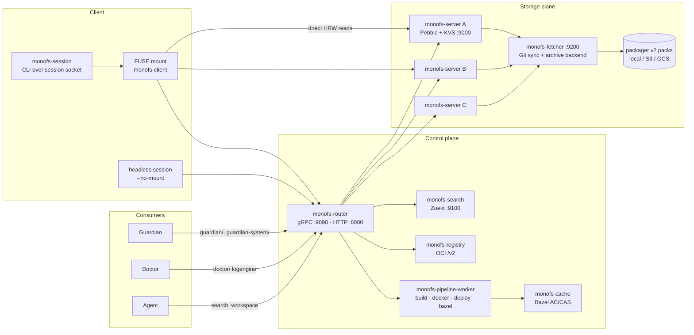
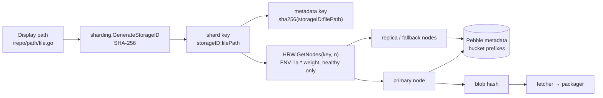
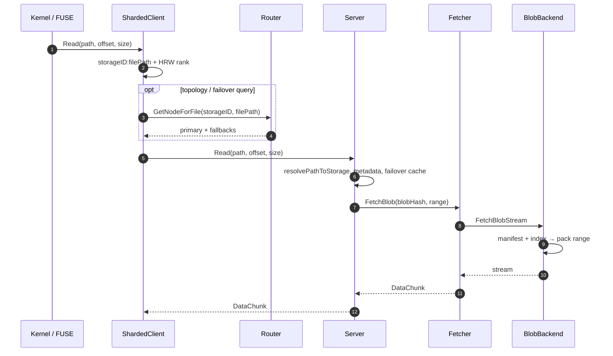
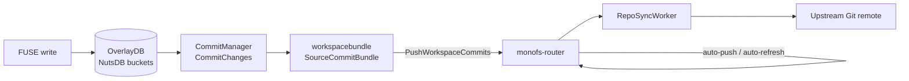

# MonoFS — Source and Storage Plane Architecture

> **Scope:** `monofs/` — router, storage nodes, fetcher, FUSE/headless client, session CLI, OCI registry, search, pipeline workers, log-engine, and the Guardian/Doctor namespaces.
> **Deep references:** [`monofs/docs/architecture.md`](https://github.com/radryc/monofs/blob/main/docs/architecture.md), [`logical-flows.md`](https://github.com/radryc/monofs/blob/main/docs/logical-flows.md), [`blob-layout-v2.md`](https://github.com/radryc/monofs/blob/main/docs/blob-layout-v2.md).

MonoFS is the substrate of Strata. It is three things at once: a **virtual monorepo workspace** (many Git repositories projected into one writable mount), a **shared object/state store** for the platform (Guardian desired state, images, telemetry chunks), and the **coordination layer** that routes work to storage nodes.

## Component topology

## Key Components

| Binary | Code home | Responsibility |
| --- | --- | --- |
| `monofs-router` | `internal/router` (`Router`), `cmd/monofs-router` | Topology/HRW, ingestion, workspace publish/push/refresh, Guardian control paths, Doctor fan-out, pipelines, registry/UI proxy, native TCP gateway. |
| `monofs-server` | `internal/server` (`Server`), `internal/metastore` | Pebble metadata + directory index, optional embedded Raft KVS, Doctor telemetry storage, request forwarding, workspace ledger. |
| `monofs-fetcher` | `internal/fetcher` (`Service`, `Registry`, `BlobBackend`) | Content proxy, Git sync worker, packager archives on local/S3/GCS. |
| `monofs-client` | `internal/client` (`ShardedClient`), `internal/fuse` (`MonoNode`, `SessionManager`) | FUSE mount or headless workspace, overlay, session socket. |
| `monofs-session` | `cmd/monofs-session` | add/rm/commit/push/read/write/stat/branch/log over the session socket. |
| `monofs-registry` | `internal/registry` (`Server`, `BlobStore`, `Proxy`) | OCI Distribution v2 registry and pull-through proxy backed by MonoFS. |
| `monofs-search` | `internal/search` (`Service`, `Indexer`) | Zoekt code search/indexing with ctags symbols. |
| `monofs-pipeline-worker` | `internal/worker` (`Worker`, `BuilderHandler`, `DockerHandler`) | Build/docker/deploy/Bazel tasks claimed from Guardian queue paths. |
| `monofs-logquery` | `cmd/monofs-logquery`, `internal/storage/logengine` | DuckDB sidecar reading a node's Parquet chunks (`:9101`). |
| `monofs-logengine-compact` | `logengine.Compactor` | Offline telemetry compaction. |
| `monofs-admin` | `cmd/monofs-admin` | ingest, status, delete, failover, rebalance, drain, rebuild-index, repos, stats. |
| `monofs-cache` | `cmd/monofs-cache` | Bazel remote cache (AC/CAS). |

## Data Model: Display Path → Storage ID → HRW Node

MonoFS separates what users see from where bytes live.

- `monopath.SplitDisplayPath` handles namespace-specific splits; `pkg/display` holds display-key mapping.
- `sharding.HRW.GetNode` scores `FNV-1a(key || nodeID) * weight` across healthy nodes; `GetNodes` yields replicas and fallbacks.
- The router snapshots topology per version, so a rebalance can serve both old and new placements (`getNodeForTopologyVersion`).
- `internal/metastore.Store` wraps Pebble with key-prefix "buckets": `metadata`, `repos`, `pathindex`, `repolookup`, `ownedfiles`, `dirindex`, `dirmeta`, `replicafiles`, `failover`.

## How It Works

### 1. Mount and read

`ShardedClient` calls router `GetClusterInfo`, builds an HRW view of active nodes, registers, and heartbeats. FUSE `MonoNode.Read` serves overlay content first; otherwise `ShardedClient.Read` picks an owner and calls node `Read`. The server resolves the display path, checks KVS/CFG namespaces, reads metadata, checks the failover cache, forwards to the HRW owner if it is not the owner, then reads through the fetcher. Negative caching and `singleflight` coalesce cold/missing blob reads.

### 2. Writes, commits, and publish

Writes never touch remote storage directly. FUSE `Open`/`Write` create a local overlay copy; `SessionManager.TrackChangeWithMeta` records each change in NutsDB (`files`, `deleted`, `userdirs`, `staged`, `commits`, `branch`, `conflicts`). `CommitManager.CommitChanges` creates a local virtual commit; `PushPendingLocalCommits` uploads a `SourceCommitBundle` to the router, which asks the fetcher's `RepoSyncWorker` to stage and push it upstream (`StageWorkspaceCommitBundle`, `StartWorkspaceCommitPush`). The router's auto-push and auto-refresh workers retry and poll upstream heads.

### 3. Ingestion from Git, files, and object stores

`Router.IngestRepository` validates source/ref, authorizes, computes the storage ID, creates a backend (`git|file|s3`), registers the repo on nodes, walks files, deduplicates by content hash, builds encrypted packager archives (2 GiB splits) streamed to `fetcher.StoreArchive`, then sends `IngestFileBatch` to primaries and best-effort `IngestReplicaBatch` to replicas. Node ingestion writes metadata and forwards inline blobs through `blobFetcher.StoreBlobBatch`. Completion marks onboarding and triggers search reindex and rebalance.

The fetcher's v2 layout is sharded: `packs/v2/sha256/<shard>/<pack>.pack`, `.idx`, and `MANIFEST.json`. Uploads are protected by a WAL and a key-fingerprint guard (`keyguard.go`).

### 4. OCI registry and Bazel cache

`monofs-registry` handles `/v2/...`; `BlobStore`/`TagStore` persist under namespace `docker-registry`. A blob miss goes through `Proxy.FetchBlob`, which pulls from the upstream registry, writes `_blobs/<digest>`, and ingests with `InlineContent`. `monofs-cache` provides Bazel AC/CAS over the same fabric.

### 5. Doctor telemetry and SQL

Ingest RPCs on the router select a node by HRW over `signal+chunkID` and proxy to node `IngestLogs/Metrics/Traces`, which call `DoctorBackend` (`logengine` or ClickHouse). Queries fan out to all healthy nodes with start/straggler/idle timeouts and merge results; the DuckDB sidecar (`monofs-logquery :9101`) accelerates SQL, with native scanning as fallback. `internal/sqlfederation` adapts the same nodes to `sqlagregator` (see [sql-federation.md](sql-federation.md)).

### 6. Guardian and Doctor namespaces

MonoFS is Guardian's database and message bus. Router-managed logical paths:

| Logical path | Physical target |
| --- | --- |
| `/partitions/...` | `guardian/<partition>` desired state + `.state`, `.archive` |
| `/.queues/...` | `guardian-system/.queues` task queue |
| `/.pipelines/...` | `guardian-system` pipeline tasks |
| `/doctor/...` | Doctor rules and telemetry control |
| `/guardian-system/...` | registry, templates, access bundle, display profiles |

Guardian writes with optimistic concurrency (`VersionID`) and watches for changes; the router supplies version history and subscriptions. Pipeline workers claim tasks from the same queue paths.

## Deployment Modes

`monofs/docker-compose.yml` defines 19 services: `fetcher-a/b`, `search-index`, HAProxy, `router-a/b`, `node-a…e`, `client/2/3`, and `logquery-a…e`. HAProxy sends gRPC/HTTP to `router-a` with `router-b` as backup. S3 mode adds MinIO (`docker-compose.s3.yml`); external S3 mode uses an existing MinIO; `docker-compose.mtls.yml` enables required mTLS. Kubernetes integration is the FUSE device plugin (`cmd/k8s-fuse-device-plugin`) plus optional Kubernetes Lease leader election for Guardian mutations and auto-refresh. There are no in-tree Kubernetes manifests; the platform manifests live in `strata/bootstrap/k8s/`.

## State Ownership and Consistency

| State | Owner | Notes |
| --- | --- | --- |
| File metadata, directory index | Storage node Pebble | Authoritative per shard. |
| File content | Fetcher packager archive | Immutable, content-addressed, encrypted. |
| Overlay/session | Client NutsDB | Local until commit; not shared. |
| Virtual commits | Client + router + fetcher | Pushed as a bundle, applied upstream by `RepoSyncWorker`. |
| Guardian state/queues | Router logical paths → nodes | Optimistic concurrency, CAS claims, version history. |
| Telemetry chunks | Storage node log-engine | Parquet + Bluge + manifest; compaction/retention offline. |

There is **no distributed transaction**. Replica ingestion is best-effort; a read may hit a replica that has not yet received a write. `ReadDir` queries all healthy nodes and errors rather than returning a partial listing.

## Notable Details and Gotchas

- **Fetcher wiring is coupled to prediction.** `monofs-server` only calls `ConfigureFetcher` when `--enable-prediction` is set (`cmd/monofs-server/main.go`). Without it, blob reads fail with `FailedPrecondition: storage node not configured: fetcher client required`. Compose/manifests must enable prediction whenever fetchers are configured.
- **Naming drift:** flags and comments still say NutsDB, but server metadata is Pebble; NutsDB remains in the FUSE overlay and client cache.
- **In-memory ingest archives:** the router buffers 2 GiB archive chunks before streaming; a partial failure can leave archives behind.
- **Key guard:** changing the fetcher encryption key without confirming a new fingerprint blocks serving until an operator confirms.
- **Dual go-git versions:** ingestion uses v5/v6 paths in different components (`GitBackend` fetch vs. ingestion).
- **Search is out-of-band:** indexing reads through MonoFS or clones Git, so a busy indexer does not add latency to the mount path.
- **Blob layout v2** avoids object listings by using shard manifests and CAS; the legacy layout remains a read fallback.

## Source Map

| Read next | Path |
| --- | --- |
| Router | `monofs/internal/router/`, `monofs/cmd/monofs-router/` |
| Server/metadata | `monofs/internal/server/`, `monofs/internal/metastore/` |
| Sharding | `monofs/internal/sharding/` (`HRW`, `GenerateStorageID`) |
| Fetcher/archives | `monofs/internal/fetcher/`, `monofs/internal/storage/blob/` |
| Client/FUSE | `monofs/internal/client/`, `monofs/internal/fuse/`, `monofs/cmd/monofs-client/` |
| Registry | `monofs/internal/registry/` |
| Search | `monofs/internal/search/` |
| Telemetry | `monofs/internal/storage/logengine/`, `monofs/internal/storage/clickhouse/` |
| Pipelines | `monofs/internal/worker/`, `monofs/internal/router/pipeline/` |
| Admin | `monofs/cmd/monofs-admin/` |
| Deployment | `monofs/docker-compose*.yml`, `strata/bootstrap/k8s/10-monofs*.yaml` |
