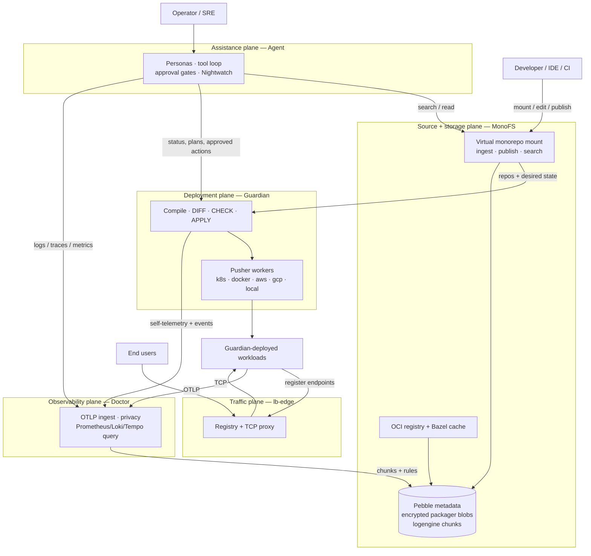
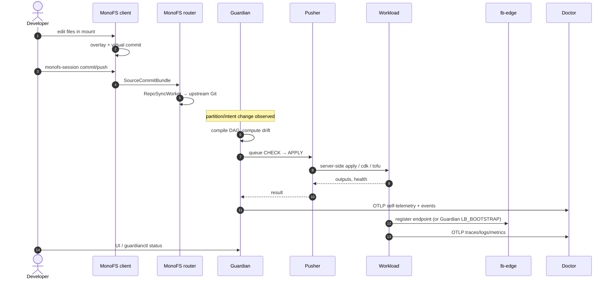
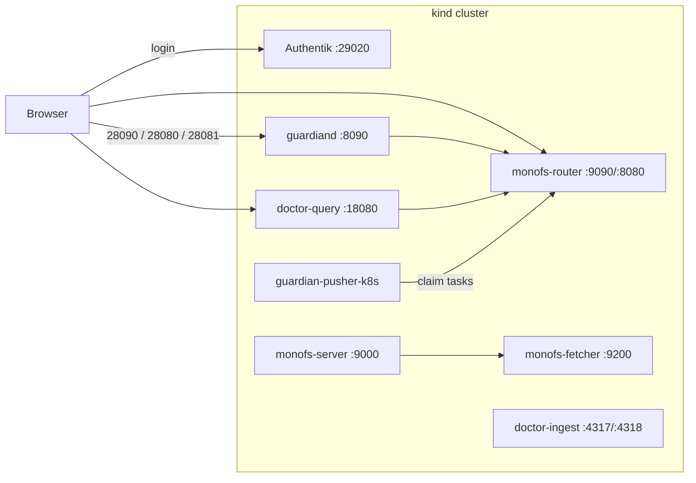

# Strata Platform Architecture — Overview

> **Scope:** the whole `/home/rydzu/strata` checkout — five runtime planes plus the shared libraries, tooling, and cloud projects that support them.
> **Audience:** engineers onboarding to the platform, reviewers of cross-component changes, and anyone who needs the system-level picture before diving into a component doc.

## What Strata Is

Strata is a self-hosted engineering platform built around one shared storage fabric. A developer mounts many Git repositories as one writable virtual monorepo (MonoFS); declares deployments as intent (Guardian); ships telemetry into a privacy-first observability backend (Doctor); routes traffic to live workloads (lb-edge); and asks an SRE assistant to investigate and propose changes (Agent). Source, desired state, container images, telemetry chunks, and deployment history all live in the same store.



## Planes and Components

| Plane | Component | Language | Runtime entry | Job |
| --- | --- | --- | --- | --- |
| Source + storage | [MonoFS](monofs.md) | Go | `monofs-router`, `monofs-server`, `monofs-fetcher`, `monofs-client` | Project repositories into one writable mount; store platform state, images, telemetry, and archives. |
| Federation | [sqlagregator](sql-federation.md) | Go | library + `sqlag` CLI | One SQL statement over CloudWatch, BigQuery, ClickHouse, Logs Insights, and MonoFS DuckDB. |
| Deployment | [Guardian](guardian.md) | Go | `guardiand`, `guardian-pusher-*`, `guardianctl` | Compile intent to assets, compute drift, queue and execute deployment tasks. |
| Traffic | [lb-edge](lb-edge.md) | Go | `lb-edge`, `lb-registry`, `lb-proxy`, `lb-k8s-agent` | Register backends and proxy raw TCP to live workloads. |
| Observability | [Doctor](doctor.md) | Go + React | `doctor-ingest`, `doctor-query`, `doctor-rules`, `doctor-sentinel` | Receive, privatize, store, query, alert on traces/logs/metrics. |
| Assistance | [Agent](agent.md) | Python + React | `app.main`, `app.nightwatch.main` | Answer with live evidence; propose/execute changes behind approval. |
| Shared storage | [kvs, cfg, packager, tlsx](shared-libraries.md) | Go | libraries | Raft KV, versioned config, encrypted archives, TLS/SPIFFE. |
| Cluster metrics | [k8s-top](cloud-deployment.md) | Go | `k8s-top` | Export pod/container usage as Guardian-attributed OTLP. |
| Cloud | [aws](cloud-deployment.md) | TypeScript CDK | ECS Fargate stacks | Run MonoFS/Guardian/Doctor on AWS; GCP is handled by Guardian's embedded pusher blueprints. |
| Entry point | [strata](bootstrap.md) | Shell | `strata/scripts/bootstrap.sh` | Clone, build, and bootstrap the stack on kind, Kubernetes, or AWS. |

## The Shared Contracts

Cross-component behavior depends on a small number of conventions rather than shared code.

### 1. MonoFS is the filesystem contract

Guardian and Doctor do not have databases. They use logical paths under the MonoFS namespace and rely on versioned reads, CAS writes, and watch events:

| Path | Owner | Contents |
| --- | --- | --- |
| `guardian/<partition>/` | Guardian | Partition config, intents, payloads, `.state`, `.archive`, `.observed`. |
| `guardian-system/` | Guardian | `.queues`, `.registry`, `.access`, `.display`, `.templates`, `.scans`. |
| `doctor/v1/` | Doctor | Rules, leases, quotas, control records. |
| `/.access/` | Access policy | Compiled policy bundle and partition-owned sources. |
| `docker-registry/` | MonoFS registry | OCI blobs and tags. |
| log-engine chunks | Doctor/MonoFS | Parquet data + Bluge index + manifest. |

### 2. Telemetry identity is `<partition>.<intent>.<asset>`

Guardian injects `OTEL_SERVICE_NAME`/`OTEL_RESOURCE_ATTRIBUTES` and `guardian.*` labels. Doctor canonicalizes resource identity to the same triple, and k8s-top copies pod labels into `guardian.target.*` attributes. This is what makes "show me logs for this asset" work across components.

### 3. Authorization is one compiled bundle

Declarative ACLs, including partition-owned grants, are compiled by Guardian into `/.access/compiled/policy.json`, served at `/api/access/policy`, and consumed by Guardian (`CanSee`/`CanModify`), Doctor (`PolicyGate`), MonoFS (repo/path reads), and the SQL router (`sql` scope). Scopes default to deny; metrics are always visible.

### 4. TLS is one environment contract

Every service honors `STRATA_TLS_MODE=off|optional|required`, `STRATA_TLS_CERT_FILE`, `STRATA_TLS_KEY_FILE`, `STRATA_TLS_CA_FILE`, `STRATA_TLS_SERVER_NAME`, and `STRATA_TLS_REQUIRE_CLIENT_CERT`. Go services use `tlsx`; the Agent implements the same contract in Python. Certificates hot-reload on handshake.

### 5. Guardian's queue is a directory convention

`guardian-system/.queues/<pusher>/<taskID>.json` plus CAS `.claims` and `.results` files is the entire message bus. Any worker that can read/write MonoFS can participate.

## End-to-End Flows

### Developer change → deployed and observed



### Incident → investigation → approved action

1. Doctor Sentinel evaluates PromQL/Guardian/CloudWatch/GCP alerts.
2. Agent (Otto) triages: TelemetryHound collects logs/metrics/traces, TopologyAuditor collects Guardian topology and drift, then Otto synthesizes a verdict.
3. Any remediation becomes a proposal; `mutate_infra` registers an approval and executes only after `confirm=true`.
4. Guardian queues the resulting task; Doctor and Nightwatch observe the outcome.

### Query fan-out

Doctor's query service authorizes once, then `proxy.Router` fans out to the local MonoFS log-engine, Guardian-managed AWS/GCP pusher read APIs, and optional static upstreams. Merges are local-first; partial results are explicitly marked. SQL queries follow the same policy: the `sqlag` catalog is projected from the caller's access scope, so unauthorized datasets never reach the planner.

## Deployment Topologies

### Local kind (default)

`strata/scripts/bootstrap.sh up` builds MonoFS, Guardian, Doctor, and the fetcher, creates a kind cluster, applies `strata/bootstrap/k8s/`, deploys Authentik, and imports platform partitions.



### Existing Kubernetes

`bootstrap.sh k8s --build --push` repeats the same flow against the current kubeconfig, with `STRATA_IMAGE_PREFIX` and the `strata` namespace.

### AWS

`bootstrap.sh aws --with-pusher` deploys the CDK project: MonoFS router/server/fetcher on ECS Fargate, Guardian, Doctor + OTLP gateway, CloudFront/Cognito, EFS + S3, and optionally the AWS pusher with its read API. See [cloud-deployment.md](cloud-deployment.md).

### Component Docker Compose

MonoFS, Guardian, Doctor, Agent, and lb each ship a compose file for isolated development (MonoFS has 19 services including HAProxy and five storage nodes; Agent adds a local llama.cpp server).

## Ports and Endpoints (common defaults)

| Service | Port | Protocol |
| --- | --- | --- |
| MonoFS router | `9090` gRPC / `8080` HTTP | gRPC, HTTP UI |
| MonoFS server | `9000` (Raft `7000`) | gRPC |
| MonoFS fetcher | `9200` | gRPC |
| MonoFS search | `9100` | gRPC |
| MonoFS logquery | `9101` | HTTP/DuckDB |
| Guardian | `8090` | HTTP UI/API |
| Guardian pusher AWS read API | `19090` | HTTP |
| Guardian pusher GCP read API | `19091` | HTTP |
| Doctor OTLP | `4317` gRPC / `4318` HTTP | OTLP |
| Doctor query | `18080` | HTTP |
| Doctor rules | `18081` | HTTP |
| lb-edge registry | `15051` gRPC / `18081` HTTP | gRPC, HTTP |
| lb-edge metrics | `19090` | Prometheus |
| Agent backend | `8090` | HTTP/WS |
| Agent UI | `3000` | HTTP |
| Agent Nightwatch | `8091` | HTTP |
| Local llama.cpp | `18080` | OpenAI-compatible |

## Security and Trust Boundaries

| Boundary | Mechanism |
| --- | --- |
| User → UI/API | OIDC/SSO (Authentik, Dex, Cognito) with authorization-code + PKCE; signed session cookies or bearer tokens. |
| Service → service | `tlsx` TLS/mTLS, SPIFFE URI SANs, bearer tokens with scopes. |
| Agent tool calls | Scoped allowlists per persona/specialist; mutating tools require `confirm=true`; every request audited. |
| Access policy | Fail-closed compiled bundle; scope-aware admins; metrics exempt by design. |
| Telemetry privacy | HMAC tokenization and secret redaction happen before WAL/persistence. |
| Guardian execution | Pushers only claim tasks; no inbound deploy API; queue files with secrets are HMAC-chained and results redacted. |
| Cloud mutation | Only Guardian pusher drivers call cloud APIs; read APIs are report-only. |

Data at rest is encrypted at multiple layers: packager archives (ChaCha20-Poly1305 per file), cfg archives, and TLS in transit. MonoFS Pebble metadata itself relies on volume encryption.

## Failure Isolation

| Failure | Blast radius | Recovery |
| --- | --- | --- |
| MonoFS node down | Reads for its shards fail; other shards continue | HRW failover to replicas; rebalance/heal; fetcher content remains available |
| MonoFS router down | No new ingest/publish; clients keep direct reads | Router HA (compose has `router-b`); clients re-resolve topology |
| Guardian down | No new reconciles | Deployed workloads keep running; pushers finish claimed tasks; queued tasks wait |
| Pusher down | Its target cloud/namespace stops changing | Lease expiry lets another compatible pusher claim |
| Doctor ingest down | Telemetry producers buffer/retry | WAL + upstream collectors; 429 backpressure is explicit |
| Doctor query down | UI/Grafana/Agent lose reads | Dashboards recover on restart; alerts in Sentinel continue if independent |
| lb-edge down | New TCP connections fail | Clients retry another proxy; registry reconstructs from agents |
| Agent down | No assistance | Platform unaffected; Nightwatch resumes from its ledger |
| Access publish invalid | Authorization fails closed | Previous bundle remains until a valid publish |

## Build and Dependency Order

```text
kvs → cfg → packager → monofs → guardian → doctor → agent → lb → k8s-top → aws
```

Go modules use `replace` directives to sibling checkouts for `kvs`, `cfg`, `packager`, `monofs`, and `sqlagregator`. `strata/scripts/clone.sh` follows `repos.txt`; `sqlagregator` is cloned separately because MonoFS replaces `github.com/radryc/sqlagregator` with `../sqlagregator`. `tlsx` resolves from the Go module proxy unless checked out locally.

## Where to Read Next

| If you want to understand… | Read |
| --- | --- |
| The virtual monorepo, storage, registry, logengine | [monofs.md](monofs.md) |
| Intent compilation, queues, pushers, rollouts | [guardian.md](guardian.md) |
| OTLP ingest, privacy, compatibility APIs, alerting | [doctor.md](doctor.md) |
| Personas, tools, approvals, Nightwatch | [agent.md](agent.md) |
| Registry/proxy and TCP data plane | [lb-edge.md](lb-edge.md) |
| Raft KV, versioned config, archives, TLS | [shared-libraries.md](shared-libraries.md) |
| Federated SQL and access projection | [sql-federation.md](sql-federation.md) |
| Bootstrapping, manifests, build order | [bootstrap.md](bootstrap.md) |
| AWS/GCP and k8s-top | [cloud-deployment.md](cloud-deployment.md) |
