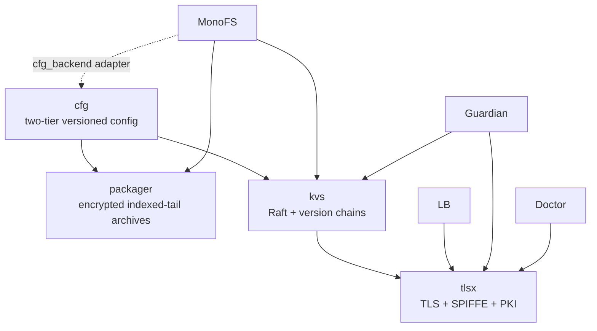
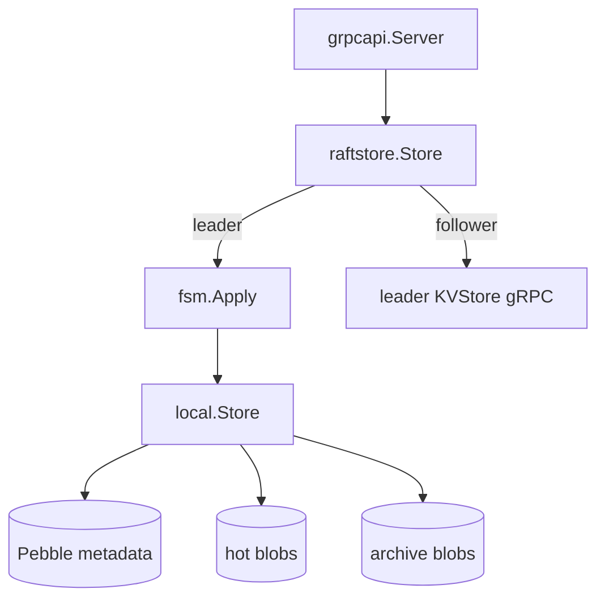
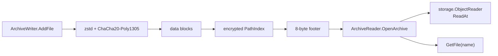
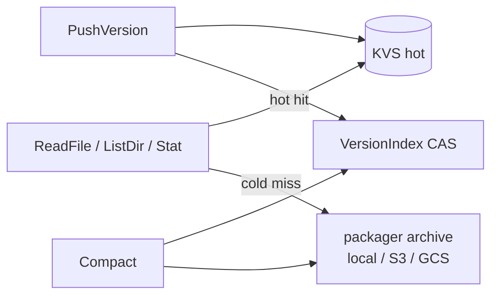

# Shared Libraries — kvs, cfg, packager, tlsx

> **Scope:** the four reusable Go modules that underpin MonoFS, Guardian, Doctor, and lb: `kvs/`, `cfg/`, `packager/`, `tlsx/`.
> **Deep references:** [`kvs/docs/guardian-versioned-kv-architecture.md`](https://github.com/radryc/kvs/blob/main/docs/guardian-versioned-kv-architecture.md), `packager/README.md`, `cfg/README.md`, `tlsx/README.md`.

These libraries are deliberately small and composable. `tlsx` is a leaf used by every service; `packager` is standalone object-storage archive I/O; `kvs` is an embedded Raft-replicated versioned KV; `cfg` layers versioned configuration on top of `kvs` and `packager`.

## Layering



## tlsx — TLS, SPIFFE, and PKI

`github.com/radryc/tlsx` is the platform-wide TLS contract. It has a Go package and a CLI.

### Configuration contract (`env.go`)

```go
type Mode string // off | optional | required

type EnvConfig struct {
    Mode            Mode
    CertFile        string
    KeyFile         string
    CAFile          string
    ServerName      string
    RequireClientCert bool
}

func LoadEnv() EnvConfig // reads STRATA_TLS_*
```

| Mode | Behavior |
| --- | --- |
| `off` | Plaintext. |
| `optional` | Serves TLS when a cert/key pair is present; falls back to plaintext. Outbound calls stay HTTP unless configured. |
| `required` | Fails closed without cert/key/CA; outbound service URLs are upgraded to HTTPS. |

`STRATA_TLS_REQUIRE_CLIENT_CERT` enables mTLS. The same variable names are implemented by the Agent's Python backend (`agent/backend/app/security/tls.py`), so a single deployment contract covers Go and Python services.

### Hot reload and verification (`tls.go`)

`certReloader` checks certificate and key modification times on every handshake through `GetCertificate`/`GetClientCertificate`. Reload is **lazy on handshake**, not a filesystem watcher, so rotation only requires replacing files. `NewServerTLSConfig`/`NewClientTLSConfig` build `*tls.Config`; `ServerCredentials`/`ClientCredentials` wrap them as gRPC transport credentials.

`VerifyPeerSPIFFE` verifies a peer certificate's URI SAN against an allowlist **after** normal chain verification. `pki.Generate` issues an ECDSA P-256 CA and leaf certificates with SPIFFE URI SANs under `strata.local`. The `tlsx` CLI (`gen`, `install`, `verify`, `env`, `list`) generates a local CA plus one certificate per service and can install the bundle as Kubernetes secrets.

## kvs — Raft-replicated versioned key-value store

`kvs` is a library, not a service binary. It is imported by `cfg` and embedded in MonoFS (`cmd/monofs-server` opens a Raft store and serves it over the KVS gRPC API).

### Public contracts (`pkg/kvsapi`)

```go
type Store interface { ReadStore; WatchStore; WriteStore }

type ReadStore interface {
    Get(ctx, path) (File, error)
    Stat(ctx, path) (FileInfo, error)
    ListDir(ctx, path) ([]FileInfo, error)
    ReadFile(ctx, path) ([]byte, error)
    GetVersion(ctx, path, versionID) (File, error)
}

type WriteStore interface {
    UpsertFiles(ctx, MutationBatch) (BatchRevision, error)
    DeletePaths(ctx, paths, expected) (BatchRevision, error)
}
```

Errors `ErrConflict` and `ErrNotLeader` drive optimistic concurrency and leader forwarding. `FetcherOffloader` lets cold blobs move to the MonoFS fetcher tier.

### Local store and version chain (`internal/store/local`)

Pebble holds metadata; blobs live under `blobs/hot` and `blobs/archive`. A write is atomic at the user-visible level:

1. Write the content blob.
2. Write a `versionManifest` (`PreviousVersionID`, `BlobPath`, `StorageClass`) plus a `latest` pointer in one Pebble batch.

Each key therefore keeps a linked chain of versions. Deletes are tombstones represented as delete versions. `dirindex.go` maintains `dir\x00<parent>\x00<child>` entries so directory listing is O(1) per entry instead of scanning prefixes.

`Purge` enforces retention: versions beyond `MaxHotVersions` move to archive, offload through `FetcherOffloader`, or are deleted beyond `MaxArchivedVersions`. Blob deletion happens only after the metadata commit, so a crash never leaves a dangling reference. Snapshots tar the data directory but intentionally skip archive blobs.

### Raft and gRPC (`pkg/raftstore`, `internal/service/grpcapi`)

`raftstore.Store` implements `kvsapi.Store` and applies JSON-encoded `commandEnvelope`s through a Hashicorp Raft FSM. BoltDB stores the Raft log and stable state. Followers do **not** apply locally: `mutateWithLeader` forwards the write to the leader's gRPC API with up to six retries, returning `ErrNotLeader` if leadership moves. The gRPC API implements the full `KVStore` service with chunked streams, bearer interceptors, and JSONL audit (`audit.go`).



## packager — encrypted, compressed archives with O(1) access

`packager` solves the small-file problem: many files in one object, retrievable individually over the network without downloading the archive.

### Writer/reader (`writer.go`, `reader.go`)

`ArchiveWriter` (`AddFile`, `Delete`, `Close`) streams files into sequential data blocks. `Close` writes a compressed, encrypted `PathIndex`, then an 8-byte little-endian footer containing the index size. `ArchiveReader` (`OpenArchive`, `WithIndexSize`, `GetFile`) reads the footer, loads the index, and performs a byte-range read of the exact file.

- **Encryption is required by default.** `pipeline.Pack` applies zstd then ChaCha20-Poly1305 (AEAD) with a unique random nonce per file. `ErrEncryptionRequired` rejects plaintext writes; legacy plaintext archives remain readable.
- **Compression is content-aware.** `detect.IsPreCompressed` skips already-compressed formats (PNG, JPEG, GIF, ZIP, MP4, 20+ others) by extension and magic bytes.
- **Metadata per entry:** Unix permissions, owner UID, file type, tombstone state, encryption and compression flags.
- **PathIndex** deduplicates directory prefixes and uses a `nameIdx` table for O(1) lookups; 100K files in 500 dirs is ~1.2 MB instead of ~6.2 MB of path strings.



`pipeline/envelope.go` adds `KeyProvider`/`KeyRingProvider` and `EncryptEnvelope` for envelope encryption. `storage/` provides `LocalFileReader`, `S3Reader`, and `GCSReader` behind `ObjectReader`. `WithIndexSize` lets callers such as cfg's `ArchiveRecord.IndexSize` skip the footer fetch entirely.

## cfg — two-tier versioned configuration

`cfg` keeps recent product configurations in KVS (hot) and moves older versions into encrypted packager archives (cold). It implements `kvsapi.Store` so a consumer can treat it as a KV store while it transparently tier-routes reads.

### Path schema and types

```
/{root}/{product}/{sha}/{file}          hot version content
/{root}/{product}/_index                VersionIndex
/{root}/{product}/current               current version pointer
/{root}/{product}/manifests/{sha}       version manifest
```

- `cfg/version.go`: `VersionIndex`, `VersionRecord`, `ArchiveRecord`, `FileRecord`; `Tier` is `hot` or `cold`.
- `cfg/index.go`: `loadIndex`/`saveIndex` use KVS `ExpectedVersionID` CAS.
- `cfg/archiver.go`: `Archiver.buildArchive` / `openArchive`; uploads to local disk, S3, or GCS.
- `cfg/store.go`: `CfgStore` with `PushVersion`, `SetCurrent`, `GetCurrent`, `ListProductVersions`, `Compact`, plus `ReadFile`/`ListDir`/`Stat`/`Watch`.

### Version lifecycle

`PushVersion` writes the file set and manifest to KVS, CAS-updates the index, then best-effort calls `Compact`. `Compact` collects the oldest excess hot versions, builds one packager archive, marks the records cold, and deletes the hot content while retaining manifests. `ReadFile` checks the hot tier first; on a miss it resolves the archive record and reads from cold storage. `Watch` is a raw KVS passthrough — cfg-specific path semantics are not translated.



### Wiring status

MonoFS exposes a `CfgBackendStore` adapter (`monofs/internal/server/cfg_backend.go`, `Server.SetCfgStore`), but the default bootstrap does not call it. Treat `cfg` as the available versioned-config layer, not as a required runtime dependency of the current stack. Guardian's own versioned state goes directly through the MonoFS store, not through `cfg`.

## Design Notes and Gotchas

- **tlsx** is the only TLS path; every Go service should load `STRATA_TLS_*` rather than construct its own config. Rotation depends on file replacement, not a watcher.
- **kvs** followers always forward writes; there is no local-apply fallback. Read-your-writes therefore depends on the leader path for mutations.
- **kvs** keeps manifests for cold and deleted versions; only blobs are purged. A manifest is the durable audit trail.
- **packager** cannot write plaintext with a current `ArchiveWriter` even if legacy plaintext archives are readable.
- **cfg** is safe to use as a `kvsapi.Store`, but watch notifications are raw KVS paths. Enabling it in MonoFS is a deployment change, not a library change.

## Source Map

| Read next | Path |
| --- | --- |
| TLS contract | `tlsx/env.go`, `tlsx/tls.go`, `tlsx/pki/pki.go` |
| KVS API | `kvs/pkg/kvsapi/types.go`, `kvs/pkg/raftstore/store.go` |
| KVS storage | `kvs/internal/store/local/store.go`, `dirindex.go`, `internal/service/grpcapi` |
| Packager | `packager/writer.go`, `reader.go`, `pathindex.go`, `pipeline/`, `storage/` |
| cfg | `cfg/store.go`, `version.go`, `index.go`, `archiver.go` |
| MonoFS adapter | `monofs/internal/server/cfg_backend.go` |
