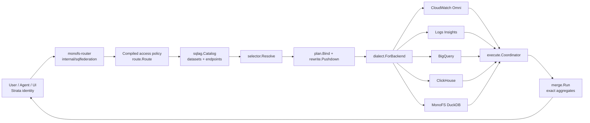
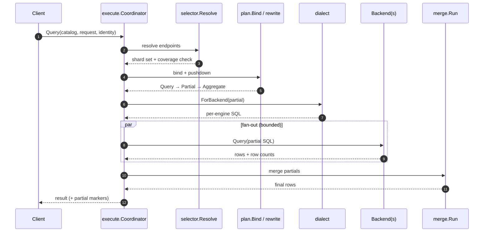

# sqlagregator — Federated SQL Architecture

> **Scope:** `sqlagregator/` — the coordinator, catalog, planner, dialect emitters, merge engine, and live drivers; plus the MonoFS SQL federation adapter that consumes it.
> **Deep references:** [`sqlagregator/DESIGN.md`](https://github.com/radryc/sqlagregator/blob/main/DESIGN.md), [`README.md`](https://github.com/radryc/sqlagregator/blob/main/README.md), [`PARTITION-POLICY.md`](https://github.com/radryc/sqlagregator/blob/main/PARTITION-POLICY.md).

`sqlagregator` is a federated SQL coordinator: one SQL statement over disjoint shards in CloudWatch Omni, CloudWatch Logs Insights, BigQuery, ClickHouse, and MonoFS node-local DuckDB. It does not proxy strings. It parses a restricted SQL subset, binds a typed logical plan, decomposes aggregates, emits per-backend SQL, fans out, and performs the final merge in pure Go.

## Position in the platform

MonoFS is the host. `monofs/internal/sqlfederation/federation.go` adapts healthy MonoFS nodes to the `sqlag` backend interface, and `route.go:Route(policy, identity, …)` projects the compiled Strata Access policy into a per-caller `sqlag.Catalog`. The router enforces `--sql-require-policy` and an `allow_partial` switch.

## Key Components

| Component | Code home | Responsibility |
| --- | --- | --- |
| Public surface | `pkg/sqlag/sqlag.go` | `NewCatalog`, `LoadCatalog`, `Request`, `PartialRequest`, `Backend`, `Coordinator`. |
| Parser + AST | `internal/sql`, `internal/ast` | Restricted SQL subset; rejects unsupported shapes rather than guessing. |
| Catalog | `internal/catalog` | `Catalog`, `Table`, `Column`, `Endpoint`, `Capabilities`, `CoverageGroup`, `PartitionBinding`. |
| Selector | `internal/selector` | `Resolve` picks endpoints, rejects replica summing and coverage gaps, supports include/exclude. |
| Planner | `internal/plan`, `internal/rewrite` | `Bind` builds `Query` → `Partial` → `Aggregate`; `Pushdown` rewrites. |
| Dialects | `internal/dialect` | `ForBackend` emits DuckDB, ClickHouse, BigQuery, Omni, and Logs Insights SQL. |
| Merge | `internal/merge` | Pure-Go hash aggregation, int128 and Neumaier compensated sums, exact distinct budgets. |
| Coordinator | `internal/execute` | `Coordinator.Query`/`Explain`: fan-out, partial-result accounting, final merge. |
| Drivers | `drivers/{omni,bigquery,clickhouse,cloudwatchlogsinsights}` | Separate Go modules; the core module does not depend on any driver. |
| CLI | `cmd/sqlag` | `backends`, `explain`, `query`. |

## How It Works

### 1. The catalog declares role and coverage — not just endpoints

A catalog endpoint declares what it can answer. `selector.Resolve` uses `Capabilities` and `CoverageGroup` to decide:

- **Shard** endpoints partition the key space; every shard must be included or the query is rejected as a coverage gap.
- **Replica** endpoints duplicate data for availability; including more than one replica would double-count, so the selector picks exactly one.
- A backend that is unreachable can be excluded only when `allow_partial` is set; otherwise the query fails closed.

This is the question that dominates the design: summing across replicas silently inflates results, so role is a first-class property.

### 2. Parsing is restricted and checking is typed

The parser accepts a deliberately small SQL subset. Unsupported constructs (`JOIN` shapes, window functions, non-decomposable aggregates) are either rejected or routed as passthrough to a single backend. Values flow through `internal/value` canonical types, so `COUNT`, `SUM`, `MIN`, `MAX`, and `AVG` merge deterministically across engines with different numeric widths.

### 3. Aggregates are decomposed into two phases

`plan.Bind` produces a logical plan; `rewrite.Pushdown` turns it into:

1. **Per-backend `Partial` query** — grouped by every non-aggregate key plus shard identity, with decomposable aggregates (`sum`, `count`, `min`, `max`, and `avg` as `sum`+`count`).
2. **Coordinator `Aggregate`** — combines partials, applies `HAVING`, ordering, and `LIMIT`.

Top-N pushdown is opt-in. Row-shaped queries (no aggregation) are pushed down whole. Non-decomposable shapes fall back to passthrough mode on a chosen backend, and `explain` reports why.

### 4. Failure and result semantics are explicit

- A failed shard without `allow_partial` aborts the query.
- With `allow_partial`, the result is marked partial and the missing endpoints are reported; the merge refuses to emit a final `SUM`/`COUNT` as if it were exact when a shard is missing unless the caller opted in.
- Results carry per-backend row counts and `explain` output so a caller can see pushdown vs. passthrough.
- Merges budget exact distinct sets; beyond the budget the query is rejected instead of approximating silently.

## Integration and Deployment

| Concern | Behavior |
| --- | --- |
| MonoFS adapter | `internal/sqlfederation/{federation,route,local_resolver,omni_resolver,insights_resolver,bigquery_resolver,clickhouse_resolver}.go`. |
| Access policy | The caller's identity is resolved through the compiled Strata Access policy; the `sql` scope becomes a per-dataset catalog. The policy is fail-closed. |
| Backends | Omni via `cloudwatchomni` (CBOR + SigV4), Logs Insights via `StartQuery`, BigQuery REST, ClickHouse HTTP/JSON, MonoFS DuckDB over gRPC. |
| Modules | Core + one module per driver, joined by `go.work` in development and by tagged versions on release. |
| Deployment | Consumed in-process by `monofs-router`; no separate service is required. The `sqlag` CLI is for operations and `explain`. |

## Notable Details

- **Plan, don't rewrite strings.** The coordinator never concatenates user SQL into a backend query; it re-emits from the bound plan per dialect.
- **Replica safety is the key invariant.** `selector.Resolve` refuses to sum replicas even when the user's SQL would appear to allow it.
- **The core has no driver dependencies.** Hosts that only import `pkg/sqlag` pull `gopkg.in/yaml.v3`, not the AWS/GCP/ClickHouse SDKs.
- **Merge is exact, not statistical.** int128 and Neumaier summation avoid float drift; distinct budgets fail rather than approximate.
- **Policy is projected, not checked after the fact.** An unauthorized dataset never enters the catalog the planner sees.

## Source Map

| Read next | Path |
| --- | --- |
| Design | `sqlagregator/DESIGN.md` (sections 4, 7, 9, 11, 15) |
| Public API | `sqlagregator/pkg/sqlag/sqlag.go` |
| Catalog/selector | `sqlagregator/internal/catalog`, `internal/selector` |
| Planner/rewrite | `sqlagregator/internal/plan`, `internal/rewrite` |
| Merge | `sqlagregator/internal/merge` |
| Coordinator | `sqlagregator/internal/execute` |
| Drivers | `sqlagregator/drivers/` |
| MonoFS adapter | `monofs/internal/sqlfederation/` |
